# PANDUAN DAFTAR GAMBAR / FOTO & NASKAH LENGKAP BAB IV

Dokumen ini berisi:
1. **Daftar Indeks & Checklist Seluruh Gambar/Foto Bab IV (`Gambar 4.1` s.d. `Gambar 4.46`)**:
   - **Gambar 4.1 s.d. Gambar 4.11 (11 Diagram Perancangan)** sudah selesai dibuat dan langsung tertaut dari folder `docs/diagrams-bab4/`.
   - **Gambar 4.12 s.d. Gambar 4.46 (35 Foto Screenshot Tampilan Website)** dilengkapi petunjuk halaman, tab, atau modal yang perlu dibuka pada aplikasi untuk diambil tangkapan layarnya (*screenshot*).
2. **Naskah Lengkap BAB IV (Hasil dan Pembahasan)** yang telah diselaraskan dengan Bab I, Bab II, Bab III, Matriks Revisi (penggunaan konsisten istilah *Point of Sale*, penguatan *Pengendalian Internal / RBAC*, metode *FIFO*, *Midtrans QRIS*, dan standar *SAK EMKM*), serta disunting dengan kaidah *humanizer* agar mengalir wajar dalam bahasa Indonesia akademis.

---

## DAFTAR CHECKLIST GAMBAR & FOTO BAB IV

### A. Diagram Perancangan Sistem (Sudah Tersedia di `docs/diagrams-bab4/`)

| Nomor Gambar | Judul Gambar di Bab IV | Subbab | File Gambar (Sudah Siap) | Status |
|---|---|---|---|---|
| **Gambar 4.1** | Arsitektur Sistem Point of Sale dan SIA SAK EMKM serta Lapisan Pengendalian Internal (RBAC) | 4.1.1 | `diagrams-bab4/11-arsitektur-sistem-rbac.png` | [x] Siap |
| **Gambar 4.2** | Diagram Use Case Sistem Point of Sale dan SIA Omah Ban Cabang 3 | 4.1.2 | `diagrams-bab4/01-use-case-diagram.png` | [x] Siap |
| **Gambar 4.3** | Flowchart Proses Login dan Pengendalian Hak Akses (RBAC) | 4.1.3.1 | `diagrams-bab4/02-flowchart-login-rbac.png` | [x] Siap |
| **Gambar 4.4** | Flowchart Transaksi Point of Sale, Pembayaran QRIS Midtrans, Alokasi FIFO, dan Jurnal Otomatis | 4.1.3.2 | `diagrams-bab4/03-flowchart-transaksi-pos-fifo.png` | [x] Siap |
| **Gambar 4.5** | Flowchart Proses Stock Opname dan Penyesuaian Nilai Persediaan FIFO | 4.1.3.3 | `diagrams-bab4/04-flowchart-stock-opname-fifo.png` | [x] Siap |
| **Gambar 4.6** | Flowchart Pengeluaran Operasional dan Siklus Pelaporan Keuangan SAK EMKM | 4.1.3.4 | `diagrams-bab4/05-flowchart-pengeluaran-pelaporan-sak-emkm.png` | [x] Siap |
| **Gambar 4.7** | Sequence Diagram Transaksi Point of Sale dan Pembayaran QRIS Midtrans | 4.1.4.1 | `diagrams-bab4/06-sequence-transaksi-pos-qris.png` | [x] Siap |
| **Gambar 4.8** | Sequence Diagram Penerimaan Barang FIFO dan Pembayaran Utang Supplier | 4.1.4.2 | `diagrams-bab4/07-sequence-pembelian-utang-fifo.png` | [x] Siap |
| **Gambar 4.9** | Sequence Diagram Stock Opname dan Penyesuaian Nilai Persediaan | 4.1.4.3 | `diagrams-bab4/08-sequence-stock-opname.png` | [x] Siap |
| **Gambar 4.10** | Sequence Diagram Pelaporan Keuangan SAK EMKM dan Tutup Buku Periode | 4.1.4.4 | `diagrams-bab4/09-sequence-pelaporan-tutup-buku.png` | [x] Siap |
| **Gambar 4.11** | Entity Relationship Diagram (ERD) Basis Data `project-skripsi_ob` | 4.1.5 | `diagrams-bab4/10-erd-omah-ban-cabang3.png` | [x] Siap |

### B. Checklist Foto / Screenshot Tampilan Website yang Perlu Diambil (`Gambar 4.12` s.d. `Gambar 4.46`)

| Nomor Gambar | Judul Gambar di Bab IV | Subbab | Cara Mengambil Screenshot di Aplikasi (`http://localhost:3000`) | Status |
|---|---|---|---|---|
| **Gambar 4.12** | Halaman Login Sistem Omah Ban Cabang 3 | 4.2.1 | Buka halaman awal saat belum login (`LoginScreen`), tampilkan form input username/email dan kata sandi. | [ ] Ambil Foto |
| **Gambar 4.13** | Halaman Dashboard Ringkasan Bisnis Pemilik | 4.2.2 | Login sebagai `owner@omahban.com`, buka menu **Dashboard** (`ExecutiveDashboardScreen`). | [ ] Ambil Foto |
| **Gambar 4.14** | Tampilan Utama Halaman Point of Sale | 4.2.3.1 | Klik tombol **Point of Sale** (`PosScreen`), tampilkan katalog ban baru/velg di kiri dan panel keranjang di kanan. | [ ] Ambil Foto |
| **Gambar 4.15** | Modal Kontrol Buka dan Tutup Shift Kasir | 4.2.3.2 | Di header halaman Point of Sale, klik tombol status **Shift Kasir** (`CashShiftControl`) saat buka/tutup shift. | [ ] Ambil Foto |
| **Gambar 4.16** | Panel Keranjang Belanja, Input Nomor Plat, dan Modal Potongan Harga Item | 4.2.3.3 | Tambahkan ban ke keranjang, isi nomor plat mobil pelanggan, lalu klik item untuk membuka `CartLineEditModal`. | [ ] Ambil Foto |
| **Gambar 4.17** | Form Tambah Jasa Servis Manual pada Point of Sale | 4.2.3.4 | Pada halaman Point of Sale, buka tab/tombol **Input Manual** (`ManualItemForm`) untuk jasa servis tambahan. | [ ] Ambil Foto |
| **Gambar 4.18** | Modal Pembayaran Transaksi Point of Sale (Tunai, Transfer, dan Split) | 4.2.3.5 | Klik tombol **Bayar / Checkout** di keranjang untuk menampilkan `CheckoutModal` beserta rincian metode bayar. | [ ] Ambil Foto |
| **Gambar 4.19** | Modal Pembayaran QRIS Dinamis Midtrans | 4.2.3.6 | Pilih metode **QRIS** pada `CheckoutModal` hingga muncul kode QR dinamis (`QrisDynamicModal`). | [ ] Ambil Foto |
| **Gambar 4.20** | Modal Transaksi Berhasil dan Pratinjau Struk Thermal 80mm | 4.2.3.7 | Selesaikan pembayaran hingga tampil `PosSuccessModal` dan pratinjau cetak struk thermal 80mm (`ReceiptPreviewModal`). | [ ] Ambil Foto |
| **Gambar 4.21** | Halaman Riwayat Struk dan Detail Nota Penjualan | 4.2.4.1 | Buka menu **Riwayat Struk** (`ThermalReceiptScreen`), pilih salah satu nota `OB3-INV-...` untuk menampilkan detailnya. | [ ] Ambil Foto |
| **Gambar 4.22** | Modal Retur Penjualan Parsial | 4.2.4.2 | Pada halaman Riwayat Struk, klik tombol **Retur** pada nota lunas untuk menampilkan `SalesReturnModal`. | [ ] Ambil Foto |
| **Gambar 4.23** | Halaman Katalog Produk Ban Baru dan Rincian Lapisan Batch FIFO | 4.2.5.1 | Buka menu **Produk & Jasa** tab **Katalog**, buka rincian batch FIFO pada salah satu produk (`ProductFifoBatchList`). | [ ] Ambil Foto |
| **Gambar 4.24** | Modal Tambah dan Ubah Data Produk Ban / Velg | 4.2.5.2 | Klik tombol **Tambah Produk** pada tab Katalog untuk menampilkan `ProductFormModal`. | [ ] Ambil Foto |
| **Gambar 4.25** | Halaman Buku Stok Bulanan FIFO | 4.2.5.3 | Pada menu **Produk & Jasa**, buka sub-tab **Buku Stok Bulanan FIFO** (`StockMonthlyLedgerView`). | [ ] Ambil Foto |
| **Gambar 4.26** | Halaman Manajemen Kategori Produk | 4.2.5.4 | Pada menu **Produk & Jasa**, buka sub-tab **Kategori** (`CategoryManagementView`). | [ ] Ambil Foto |
| **Gambar 4.27** | Halaman Master Jasa Servis dan Spooring | 4.2.5.5 | Pada menu **Produk & Jasa**, buka sub-tab **Jasa Servis** (`ServiceManagementView`). | [ ] Ambil Foto |
| **Gambar 4.28** | Halaman Mutasi Stok dan Drawer Kartu Stok Produk | 4.2.5.6 | Buka sub-tab **Penerimaan & Stok Opname** atau klik **Kartu Stok** pada produk untuk menampilkan `StockCardDrawer`. | [ ] Ambil Foto |
| **Gambar 4.29** | Modal Penerimaan Barang Distributor (Goods Receipt) | 4.2.5.7 | Klik tombol **Terima Barang (Restock)** untuk menampilkan `GoodsReceiptModal` (input faktur supplier, termin, dan harga batch). | [ ] Ambil Foto |
| **Gambar 4.30** | Modal Retur Pembelian dan Pembatalan Penerimaan Barang | 4.2.5.8 | Pada daftar penerimaan barang, klik **Retur / Batal Penerimaan** untuk menampilkan `PurchaseReturnModal`. | [ ] Ambil Foto |
| **Gambar 4.31** | Modal Pemeriksaan Fisik Barang (Stock Opname) | 4.2.5.9 | Klik tombol **Stock Opname** untuk menampilkan `StockOpnameModal` beserta perbandingan stok sistem vs fisik. | [ ] Ambil Foto |
| **Gambar 4.32** | Halaman Data Rekanan Distributor (Supplier) | 4.2.5.10 | Pada menu **Produk & Jasa**, buka sub-tab **Supplier** beserta modal tambah supplier (`SupplierFormModal`). | [ ] Ambil Foto |
| **Gambar 4.33** | Form Pencatatan Pengeluaran Biaya Operasional Toko | 4.2.6.1 | Buka menu **Biaya Toko** (`ExpensesScreen`), tampilkan form input pengeluaran (`ExpenseForm`). | [ ] Ambil Foto |
| **Gambar 4.34** | Tabel Riwayat Pengeluaran dan Bukti Kas Keluar (BKK) | 4.2.6.2 | Tampilkan tabel daftar pengeluaran (`ExpenseTable`) dan modal cetak voucher `BKK` (`ExpenseVoucherModal`). | [ ] Ambil Foto |
| **Gambar 4.35** | Halaman Jurnal Umum dan Modal Input Jurnal Manual | 4.2.7.1 | Buka menu **Buku Besar** tab **1. Jurnal Umum** (`JournalTab`) beserta `ManualJournalModal`. | [ ] Ambil Foto |
| **Gambar 4.36** | Modal Jurnal Penyesuaian (AJP Akrual dan Prabayar) | 4.2.7.2 | Di header menu **Buku Besar**, klik tombol **AJP Akrual / Dibayar di Muka** (`AdjustingEntryModal`). | [ ] Ambil Foto |
| **Gambar 4.37** | Halaman Buku Besar per Akun (General Ledger) | 4.2.7.3 | Pada menu **Buku Besar**, buka tab **2. Buku Besar** (`GeneralLedgerTab`) dan pilih salah satu akun (misal `1-1000` atau `1-2000`). | [ ] Ambil Foto |
| **Gambar 4.38** | Halaman Neraca Saldo Seimbang (Trial Balance) | 4.2.7.4 | Pada menu **Buku Besar**, buka tab **3. Neraca Saldo** (`TrialBalanceTab`). | [ ] Ambil Foto |
| **Gambar 4.39** | Halaman Buku Pembantu Utang Supplier dan Modal Pembayaran Utang | 4.2.7.5 | Pada menu **Buku Besar**, buka tab **4. Pembantu Hutang** (`AccountsPayableTab`) dan modal bayar utang (`PayDebtModal`). | [ ] Ambil Foto |
| **Gambar 4.40** | Halaman Kas & Bank (Approval Shift Kasir, Setor Bank, Prive, Modal) | 4.2.7.6 | Pada menu **Buku Besar**, buka tab **6. Kas & Bank** (`CashBankTab`). | [ ] Ambil Foto |
| **Gambar 4.41** | Halaman Register Aset Tetap dan Eksekusi Penyusutan Bulanan | 4.2.7.7 | Pada menu **Buku Besar**, buka tab **7. Aset Tetap** (`FixedAssetsTab`) beserta modal tambah aset (`FixedAssetModal`). | [ ] Ambil Foto |
| **Gambar 4.42** | Halaman Rekonsiliasi Bank BCA | 4.2.7.8 | Pada menu **Buku Besar**, buka tab **8. Rekonsiliasi Bank** (`BankReconciliationTab`). | [ ] Ambil Foto |
| **Gambar 4.43** | Modal Saldo Awal Akun dan Modal Tutup Buku Periode | 4.2.7.9 | Di header menu **Buku Besar**, buka tombol **Saldo Awal** (`OpeningBalanceModal`) atau **Tutup Buku** (`PeriodClosingModal`). | [ ] Ambil Foto |
| **Gambar 4.44** | Halaman Laporan Keuangan SAK EMKM (Laba Rugi, Posisi Keuangan, Perubahan Ekuitas, Arus Kas, dan CALK) | 4.2.8 | Buka menu **Laporan Keuangan** (`FinancialStatementsScreen` / `SakEmkmReportTab`), tampilkan sub-tab Laba Rugi, Neraca, Arus Kas, dan CALK. | [ ] Ambil Foto |
| **Gambar 4.45** | Halaman Laporan Operasional Harian (Kas Harian dan Rekap Harian) | 4.2.9 | Buka menu **Laporan Harian** (`DailyReportsScreen`), tampilkan tab **Kas Harian** dan **Rekap Harian**. | [ ] Ambil Foto |
| **Gambar 4.46** | Halaman Pengaturan Sistem, Provider Pembayaran QRIS/Bank, dan Matriks Hak Akses (RBAC) | 4.2.10 | Buka menu **Pengaturan** (`SettingsScreen`), tampilkan tab **Metode Pembayaran** (`PaymentMethodsTab`) dan **Peran & Hak Akses** (`RolePermissionsTab`). | [ ] Ambil Foto |

---
# BAB IV
# HASIL DAN PEMBAHASAN

Bab ini menguraikan hasil perancangan, pembangunan, dan pengujian Sistem Point of Sale dan Sistem Informasi Akuntansi berbasis website pada Toko Ban dan Velg Omah Ban Cabang 3. Pembahasan disusun mengikuti tahapan metode Rapid Application Development (RAD) yang telah ditetapkan pada Bab III, dimulai dari pemodelan perancangan sistem dan pengendalian internal, implementasi antarmuka website beserta integrasi pembukuan SAK EMKM dan alokasi persediaan FIFO, hingga pengujian fungsionalitas menggunakan metode Black-Box Testing serta evaluasi penerimaan pengguna melalui wawancara.

## 4.1. Perancangan Sistem

Tahap perancangan sistem menerjemahkan hasil identifikasi masalah operasional di Cabang 1 dan Cabang 2 serta spesifikasi kebutuhan Omah Ban Cabang 3 pada Tabel 3.2 ke dalam model teknis sebelum penulisan kode program. Pemodelan ini mencakup arsitektur sistem dan pengendalian internal berbasis Role-Based Access Control (RBAC), diagram kasus pengguna (Use Case Diagram), diagram alir sistem (Flowchart), diagram urutan interaksi komponen (Sequence Diagram), serta rancangan basis data relasional (Entity Relationship Diagram) beserta bagan akun standar SAK EMKM.

### 4.1.1. Arsitektur Sistem dan Pengendalian Internal (RBAC)

Sistem informasi Omah Ban Cabang 3 dibangun dengan arsitektur web terpisah antara lapisan antarmuka pengguna (front-end) berbasis React 19 dan TypeScript dengan lapisan layanan aplikasi (back-end) berbasis REST API Laravel 13 dan basis data MySQL 8. Pemisahan kedua lapisan ini bertujuan agar antarmuka Point of Sale di meja kasir dapat merespons pencarian ban dan pemindaian transaksi secara cepat tanpa pemuatan ulang halaman, sementara seluruh perhitungan uang, pemotongan lapisan harga pokok FIFO, penomoran dokumen, serta pembentukan ayat jurnal tetap dikendalikan secara terpusat di sisi peladen (server-authoritative). Gambar 4.1 menunjukkan arsitektur sistem beserta lapisan pengendalian internal yang diterapkan.

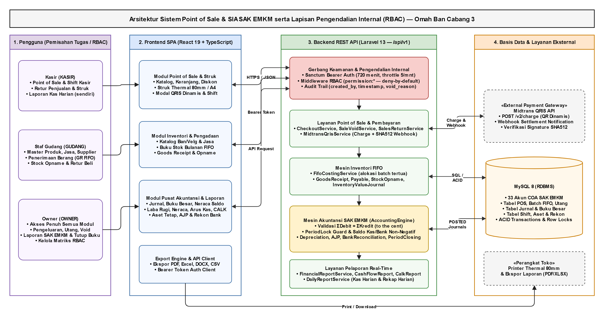
**Gambar 4.1 Arsitektur Sistem Point of Sale dan SIA SAK EMKM serta Lapisan Pengendalian Internal (RBAC)**
*Sumber: Peneliti (2026)*

Berdasarkan Gambar 4.1, sistem dibagi ke dalam empat lapisan yang menerapkan empat unsur pengendalian internal menurut Romney dan Steinbart (2017) serta Hall (2008):

1. Pemisahan Tugas (Segregation of Duties): Sistem membagi pengguna ke dalam tiga peran yang terpisah sesuai struktur operasional toko, yaitu Kasir (`KASIR`), Staf Gudang (`GUDANG`), dan Pemilik Toko (`OWNER`). Kasir hanya berwenang menjalankan pelayanan transaksi Point of Sale, membuka dan menutup shift kas laci, memproses retur penjualan, serta melihat laporan kas harian miliknya sendiri. Staf Gudang memegang fungsi pengelolaan fisik persediaan yang mencakup pemeliharaan katalog ban baru dan velg, penerimaan barang dari distributor resmi (goods receipt), retur pembelian, serta pemeriksaan fisik barang (stock opname). Fungsi otorisasi keuangan, pencatatan beban, pelunasan utang distributor, penyesuaian akuntansi, dan penyusunan laporan keuangan SAK EMKM dikunci khusus untuk peran Owner.
2. Pengendalian Akses (Access Controls): Setiap permintaan data dari antarmuka React wajib menyertakan token autentikasi Laravel Sanctum (`Authorization: Bearer`) dengan masa berlaku 720 menit dan pembatasan percobaan masuk (throttling) maksimal lima kali per menit. Di sisi server, setiap jalur API dilindungi oleh middleware `permission:<key>` dengan prinsip tolak-secara-bawaan (deny-by-default). Apabila akun Kasir atau Staf Gudang mencoba mengakses titik akhir (endpoint) pembukuan atau laporan keuangan di luar wewenangnya, server menolak permintaan tersebut dengan kode status `403 Forbidden`.
3. Otorisasi Transaksi dan Pengendalian Fisik Kas: Transaksi penjualan tunai maupun pengembalian uang retur tunai pada Point of Sale wajib melewati validasi shift kasir terbuka (`CashSessionService::requireOpen()`). Pada akhir jam kerja, kasir menghitung uang fisik di laci dan menutup shift dengan status menunggu persetujuan (`PENDING_APPROVAL`). Selisih antara uang fisik dengan saldo buku akun `1-1000 Kas Toko Laci Kasir` baru dibukukan ke akun `6-1010 Selisih Kas Kasir` setelah diperiksa dan disetujui oleh Owner. Selain itu, mesin akuntansi (`AccountingEngine`) menolak setiap transaksi pengeluaran yang dapat menyebabkan saldo Kas Laci (`1-1000`) atau Bank BCA (`1-1001`) bernilai negatif, serta menolak pencatatan transaksi pada tanggal yang telah melewati tanggal kunci periode tutup buku (`PeriodLock`).
4. Jejak Audit (Audit Trail): Setiap dokumen transaksi diberikan nomor referensi berurutan secara otomatis di dalam transaksi basis data (`OB3-INV-YYYYMM-####` untuk penjualan, `GR-YYYYMM-####` untuk penerimaan barang, `OPN-YYYYMM-####` untuk stock opname, `BKK-YYYYMM-####` untuk pengeluaran biaya, dan `JRN-YYYYMM-####` untuk jurnal umum). Jurnal yang telah diposting tidak dapat dihapus atau diubah secara langsung; setiap koreksi wajib melalui transaksi pembatalan (void) atau jurnal pembalik yang merekam identitas pengguna (`created_by` / `voided_by`), waktu kejadian (`timestamp`), alasan pembatalan (`void_reason`), serta tautan ke jurnal asal (`reversal_of_id`).

Pembagian hak akses bawaan untuk ketiga peran pengguna pada sistem Omah Ban Cabang 3 dirangkum pada Tabel 4.1.

**Tabel 4.1 Matriks Pembagian Hak Akses Pengguna (Role-Based Access Control)**

| Kunci Izin (`PermissionKey`) | Fungsi dan Ruang Lingkup Modul | Kasir (`KASIR`) | Staf Gudang (`GUDANG`) | Owner (`OWNER`) |
|---|---|---|---|---|
| `pos` | Mengoperasikan antarmuka Point of Sale dan memproses checkout penjualan | Ya | Tidak | Ya |
| `cash_session` | Membuka dan menutup shift kas laci kasir (`1-1000`) | Ya | Tidak | Ya |
| `receipt` | Melihat riwayat struk belanja dan mencetak ulang struk thermal 80mm / nota A4 | Ya | Tidak | Ya |
| `sales_return` | Memproses retur penjualan parsial (maksimal usia nota 30 hari untuk non-Owner) | Ya | Tidak | Ya |
| `daily_reports` | Melihat laporan kas harian (Kasir hanya melihat nota dan shift miliknya sendiri) | Ya (Terbatas) | Tidak | Ya (Semua) |
| `inventory_view` | Melihat katalog ban/velg, lapisan batch FIFO, kartu stok, dan buku stok bulanan | Tidak | Ya | Ya |
| `inventory_manage` | Menambah, mengubah, dan menonaktifkan master produk, kategori, jasa, dan supplier | Tidak | Ya | Ya |
| `goods_receipt` | Mencatat penerimaan barang baru dari distributor (`GR`) dan membentuk batch FIFO | Tidak | Ya | Ya |
| `purchase_return` | Memproses retur pembelian atau pembatalan penerimaan barang (`RTB`) | Tidak | Ya | Ya |
| `stock_opname` | Menjalankan pemeriksaan fisik stok (`OPN`), impor Excel awal, dan rekonsiliasi stok | Tidak | Ya | Ya |
| `dashboard` | Mengakses dashboard eksekutif dan grafik rekapitulasi pendapatan harian/bulanan | Tidak | Tidak | Ya |
| `sale_void` | Membatalkan (void) nota penjualan dan membalik jurnal serta alokasi batch FIFO | Tidak | Tidak | Ya |
| `expenses` | Mencatat dan membatalkan pengeluaran biaya operasional toko (`BKK`) | Tidak | Tidak | Ya |
| `accounts_payable` | Mengakses buku pembantu utang distributor dan mencatat pelunasan faktur tempo | Tidak | Tidak | Ya |
| `cash_session_approve` | Menyetujui penutupan shift kasir dan membukukan selisih kas (`6-1010`) | Tidak | Tidak | Ya |
| `cash_movement` | Mencatat setoran kas laci ke bank, pengambilan prive pemilik, dan setoran modal | Tidak | Tidak | Ya |
| `fixed_assets` | Mengelola register aset tetap bengkel dan menjalankan penyusutan bulanan | Tidak | Tidak | Ya |
| `bank_reconciliation` | Melakukan rekonsiliasi mutasi rekening Bank BCA (`1-1001`) dan impor CSV mutasi | Tidak | Tidak | Ya |
| `accounting_hub` | Mengakses Jurnal Umum, Buku Besar, Neraca Saldo, Jurnal Manual, AJP, dan Tutup Buku | Tidak | Tidak | Ya |
| `financial_reports` | Mengakses dan mengekspor Laporan Keuangan SAK EMKM serta CALK | Tidak | Tidak | Ya |
| `role_settings` | Mengatur profil toko, provider pembayaran & tarif MDR QRIS, serta matriks RBAC | Tidak | Tidak | Ya |

*Sumber: Peneliti (2026)*

### 4.1.2. Diagram Use Case

Diagram Use Case digunakan untuk memetakan interaksi fungsional antara ketiga aktor pengguna dan layanan pembayaran eksternal terhadap seluruh fitur yang dibangun di dalam sistem. Gambar 4.2 menyajikan Diagram Use Case Sistem Point of Sale dan Sistem Informasi Akuntansi Omah Ban Cabang 3.

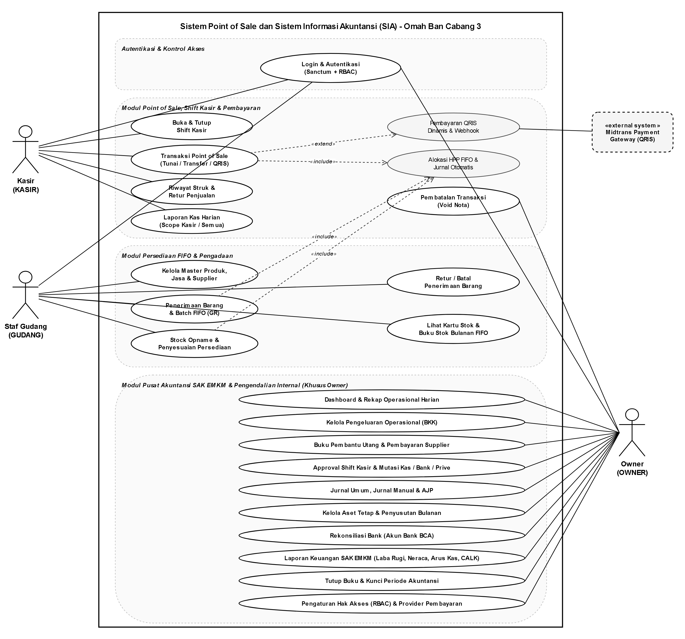
**Gambar 4.2 Diagram Use Case Sistem Point of Sale dan SIA Omah Ban Cabang 3**
*Sumber: Peneliti (2026)*

Sebagaimana terlihat pada Gambar 4.2, seluruh pengguna wajib melewati kasus penggunaan Login & Autentikasi terlebih dahulu untuk memuat sesi token dan matriks hak aksesnya. Pada kelompok modul Point of Sale, aktor Kasir berinteraksi dengan empat kasus penggunaan utama, yaitu Buka & Tutup Shift Kasir, Transaksi Point of Sale, Riwayat Struk & Retur Penjualan, serta Laporan Kas Harian. Kasus penggunaan Transaksi Point of Sale memiliki relasi `«include»` terhadap Alokasi HPP FIFO & Jurnal Otomatis, karena setiap transaksi penjualan barang wajib memotong stok dari batch pembelian tertua sekaligus membentuk jurnal umum secara otomatis di latar belakang. Selain itu, Transaksi Point of Sale memiliki relasi `«extend»` terhadap Pembayaran QRIS Dinamis & Webhook yang terhubung langsung dengan sistem eksternal Midtrans Payment Gateway ketika pelanggan memilih metode pembayaran QRIS.

Pada kelompok modul Persediaan FIFO dan Pengadaan, aktor Staf Gudang mengelola Master Produk, Jasa & Supplier, mencatat Penerimaan Barang & Batch FIFO (`GR`), memproses Retur atau Batal Penerimaan Barang, menjalankan Stock Opname & Penyesuaian Persediaan, serta memantau Kartu Stok dan Buku Stok Bulanan FIFO. Baik penerimaan barang maupun stock opname memiliki relasi `«include»` dengan pembentukan lapisan batch FIFO dan penjurnalan otomatis agar nilai persediaan pada akun `1-2000` selalu sama dengan total kuantitas tersisa dikalikan harga modal per batch.

Pada kelompok modul Pusat Akuntansi SAK EMKM dan Pengendalian Internal, aktor Owner memegang kendali atas sepuluh kasus penggunaan pengawasan keuangan, ditambah hak eksklusif untuk melakukan Pembatalan Transaksi (Void Nota). Melalui pembagian ini, kegiatan operasional di meja kasir dan gudang dapat berjalan paralel setiap hari, sedangkan seluruh mutasi keuangan bermuara secara otomatis ke pusat akuntansi yang diawasi oleh pemilik toko.

### 4.1.3. Flowchart Sistem

Pada Bab III telah disajikan Flowchart Proses Bisnis Penjualan (Gambar 3.2) dan Flowchart Proses Bisnis Pembelian (Gambar 3.3) yang menggambarkan alur kerja bisnis antarbagian di toko. Untuk memperjelas logika pemrosesan di dalam perangkat lunak pada tahap *User Design*, disusun empat flowchart teknis yang merinci mekanisme pengendalian akses, validasi transaksi Point of Sale dengan QRIS Midtrans dan FIFO, penyesuaian fisik stock opname, serta siklus pengeluaran biaya hingga pelaporan keuangan SAK EMKM.

#### 4.1.3.1. Flowchart Proses Login dan Pengendalian Hak Akses (RBAC)

Gambar 4.3 menggambarkan alur autentikasi pengguna dan cara sistem menegakkan pengendalian akses berbasis peran pada setiap halaman maupun permintaan API.

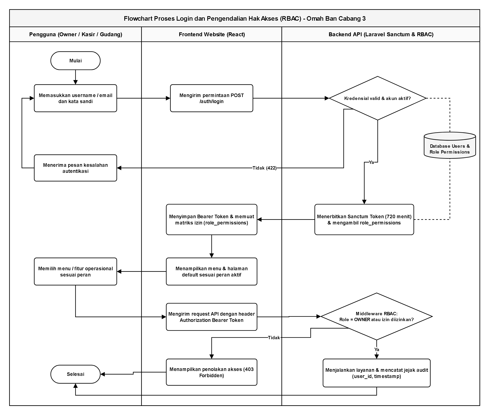
**Gambar 4.3 Flowchart Proses Login dan Pengendalian Hak Akses (RBAC)**
*Sumber: Peneliti (2026)*

Berdasarkan Gambar 4.3, proses dimulai saat pengguna memasukkan nama pengguna (username) atau alamat email beserta kata sandi pada layar login. Antarmuka React mengirimkan data tersebut melalui permintaan `POST /api/v1/auth/login` ke server Laravel. Server memeriksa kecocokan kredensial dan status keaktifan akun (`is_active`) pada tabel `users`. Apabila kredensial tidak sesuai atau akun berstatus nonaktif, server mengembalikan kode kesalahan `422 Unprocessable Entity` dan pengguna diminta mengulangi pengisian.

Apabila kredensial valid, server menerbitkan token sesi Sanctum, mengambil matriks izin peran dari tabel `role_permissions`, lalu mengirimkannya kembali ke peramban. Aplikasi React menyimpan token tersebut, menyembunyikan menu navigasi yang tidak diizinkan, dan mengarahkan pengguna ke layar bawaan sesuai perannya (layar Point of Sale untuk Kasir, layar Produk & Jasa untuk Staf Gudang, dan layar Dashboard untuk Owner). Selanjutnya, setiap kali pengguna mengakses fitur atau mengirim transaksi ke server, middleware RBAC memeriksa apakah pengguna memiliki peran `OWNER` atau memiliki kunci izin yang disyaratkan. Permintaan yang sah akan diproses beserta pencatatan jejak audit (`user_id` dan waktu transaksi), sedangkan permintaan tanpa izin langsung ditolak dengan status `403 Forbidden`.

#### 4.1.3.2. Flowchart Transaksi Point of Sale, Pembayaran QRIS Midtrans, Alokasi FIFO, dan Jurnal Otomatis

Gambar 4.4 merinci logika validasi berlapis yang dijalankan oleh sistem saat kasir memproses transaksi penjualan di meja kasir.

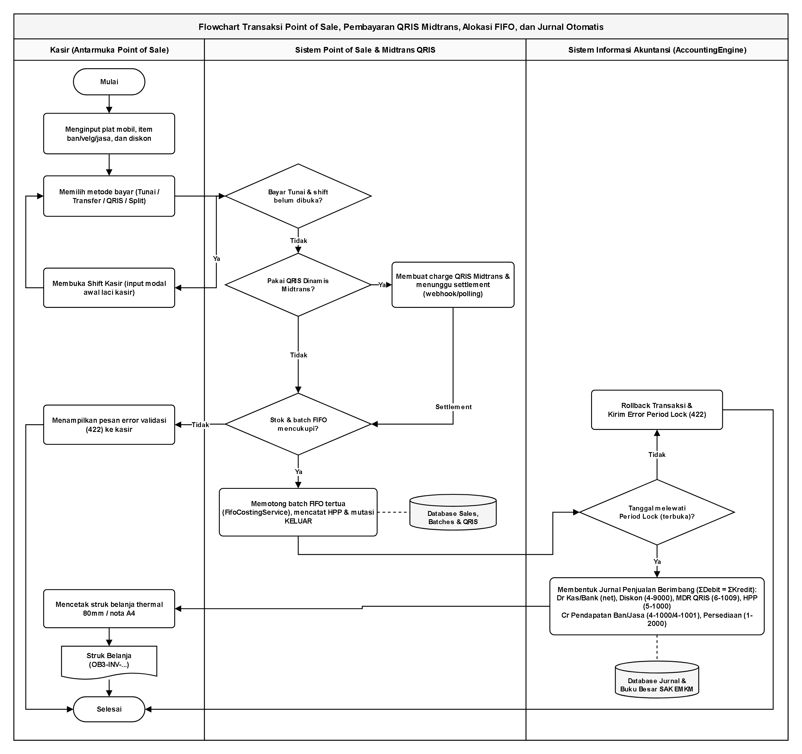
**Gambar 4.4 Flowchart Transaksi Point of Sale, Pembayaran QRIS Midtrans, Alokasi FIFO, dan Jurnal Otomatis**
*Sumber: Peneliti (2026)*

Berdasarkan Gambar 4.4, setelah kasir menginput nomor plat kendaraan pelanggan, memilih ban baru, velg, atau jasa servis, dan menentukan metode pembayaran (Tunai, Transfer Bank, QRIS, atau pembayaran gabungan/split), sistem melakukan tiga tahap pemeriksaan sebelum transaksi dapat disimpan:

1. Pemeriksaan Shift Kasir: Jika transaksi melibatkan penerimaan uang tunai (`TUNAI`), sistem memeriksa apakah terdapat shift kasir yang sedang berstatus `OPEN` pada tabel `cash_sessions`. Apabila shift belum dibuka, sistem menolak checkout dan meminta kasir membuka shift terlebih dahulu dengan menginput uang modal awal laci kasir.
2. Pemeriksaan Pembayaran QRIS Dinamis Midtrans: Jika pelanggan membayar menggunakan QRIS Dinamis, sistem memanggil endpoint `POST /api/v1/payment/qris/charge` untuk menerbitkan kode QR dari Midtrans dan mencatat pesanan pada tabel `qris_transactions` dengan status `pending`. Sistem kemudian menunggu konfirmasi pelunasan (`settlement`) melalui notifikasi webhook Midtrans yang diverifikasi menggunakan tanda tangan kriptografi SHA-512 atau melalui pemeriksaan status berkala. Saat checkout dikirimkan, baris `qris_transactions` dikunci dan diverifikasi agar satu transaksi QRIS yang telah lunas hanya dapat diklaim satu kali dengan nominal yang persis sama.
3. Pemeriksaan Stok dan Lapisan Batch FIFO: Sistem mengunci baris produk terkait pada database dan memeriksa ketersediaan stok pada tabel `products` maupun lapisan `product_batches`. Apabila jumlah ban yang dibeli melebihi sisa kuantitas pada lapisan batch FIFO, transaksi ditolak (`422`) untuk mencegah saldo persediaan negatif atau HPP tanpa dasar harga perolehan.

Apabila seluruh validasi terpenuhi, `FifoCostingService::allocateFifo()` memotong `remaining_qty` dimulai dari batch dengan tanggal pembelian (`purchase_date`) paling tua, menyimpan rincian alokasi ke tabel `sale_batch_allocations`, mencatat kartu stok keluar pada `stock_movements`, serta menghitung total HPP. Selanjutnya, `AccountingEngine::createEntry()` memeriksa apakah tanggal transaksi berada pada periode akuntansi yang masih terbuka (`PeriodLock`). Jika periode terbuka, sistem membentuk jurnal penjualan berimbang dengan mendebit Kas Laci (`1-1000`) atau Bank BCA (`1-1001`) sebesar penerimaan bersih, Beban MDR QRIS (`6-1009`) bila ada potongan biaya penyedia QRIS, Potongan Diskon Penjualan (`4-9000`) bila ada diskon, serta HPP Ban Baru (`5-1000`), kemudian mengkredit Pendapatan Penjualan Ban Baru (`4-1000`), Pendapatan Jasa Servis & Spooring (`4-1001`), serta Persediaan Ban Baru (`1-2000`) sebesar nilai HPP FIFO. Seluruh proses ini berjalan di dalam satu transaksi database (`DB::transaction`), sehingga kegagalan pada salah satu tahap akan membatalkan (rollback) keseluruhan perubahan secara utuh.

#### 4.1.3.3. Flowchart Proses Stock Opname dan Penyesuaian Nilai Persediaan FIFO

Gambar 4.5 menunjukkan alur pemeriksaan fisik stok ban dan velg oleh Staf Gudang beserta mekanisme sinkronisasi otomatis antara lapisan batch FIFO dengan saldo buku besar persediaan.

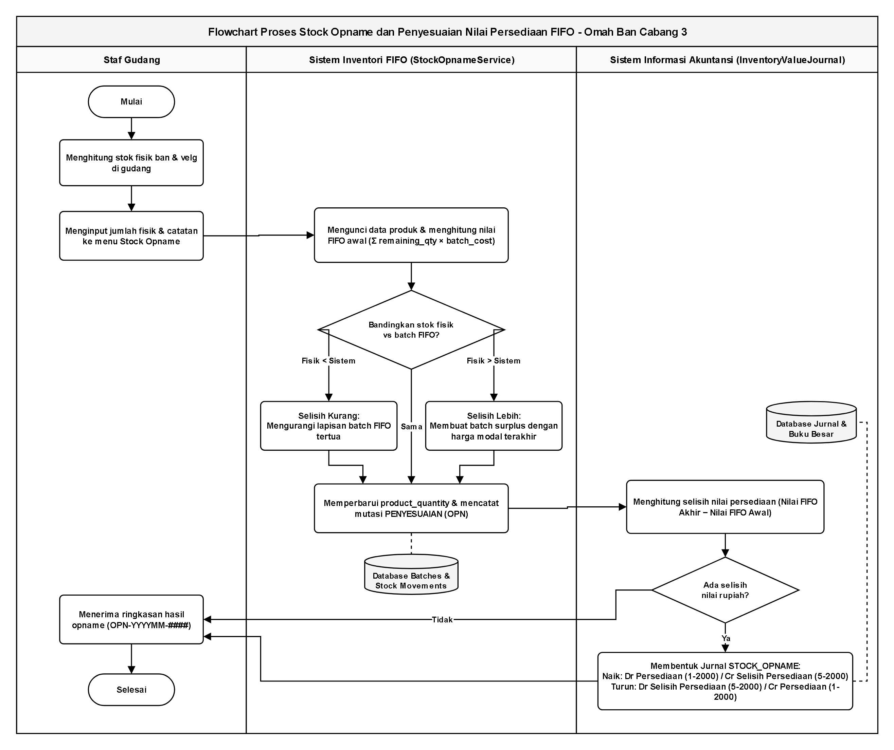
**Gambar 4.5 Flowchart Proses Stock Opname dan Penyesuaian Nilai Persediaan FIFO**
*Sumber: Peneliti (2026)*

Berdasarkan Gambar 4.5, Staf Gudang terlebih dahulu menghitung jumlah fisik ban dan velg di gudang, lalu memasukkan hasil perhitungan fisik beserta catatannya ke menu Stock Opname. Saat data dikirimkan ke server (`POST /api/v1/inventory/stock-opname`), layanan `StockOpnameService` mengunci baris produk yang diperiksa dan memanggil `InventoryValueJournal::record()` untuk menghitung total nilai rupiah persediaan FIFO sebelum penyesuaian ($\sum \text{remaining\_qty} \times \text{batch\_cost}$).

Sistem kemudian membandingkan kuantitas fisik hasil opname dengan total kuantitas pada lapisan batch FIFO yang aktif. Apabila jumlah fisik lebih kecil daripada catatan sistem (selisih kurang), sistem mengurangi kuantitas dari lapisan batch FIFO tertua terlebih dahulu. Sebaliknya, apabila jumlah fisik lebih besar daripada catatan sistem (selisih lebih), sistem membuat lapisan batch surplus baru menggunakan harga modal pembelian terakhir produk tersebut. Setelah lapisan batch disesuaikan, sistem memperbarui kolom `product_quantity` pada tabel `products` dan mencatat riwayat mutasi bertipe `PENYESUAIAN` dengan nomor dokumen `OPN-YYYYMM-####` pada tabel `stock_movements`.

Pada tahap akhir, `InventoryValueJournal` menghitung kembali total nilai rupiah persediaan FIFO setelah opname. Apabila terdapat selisih nilai rupiah antara kondisi sebelum dan sesudah opname, sistem secara otomatis memposting jurnal `STOCK_OPNAME`: jika nilai persediaan bertambah, akun `1-2000 Persediaan Ban Baru Cabang 3` didebit dan akun `5-2000 Selisih Persediaan (Opname)` dikredit; jika nilai persediaan berkurang, akun `5-2000` didebit dan akun `1-2000` dikredit. Mekanisme ini menjamin saldo akun persediaan di Neraca selalu sama dengan total nilai lapisan batch FIFO di gudang.

#### 4.1.3.4. Flowchart Pengeluaran Operasional dan Siklus Pelaporan Keuangan SAK EMKM

Gambar 4.6 memperlihatkan alur pencatatan pengeluaran biaya operasional harian hingga proses penyusunan laporan keuangan akhir periode dan penguncian buku.

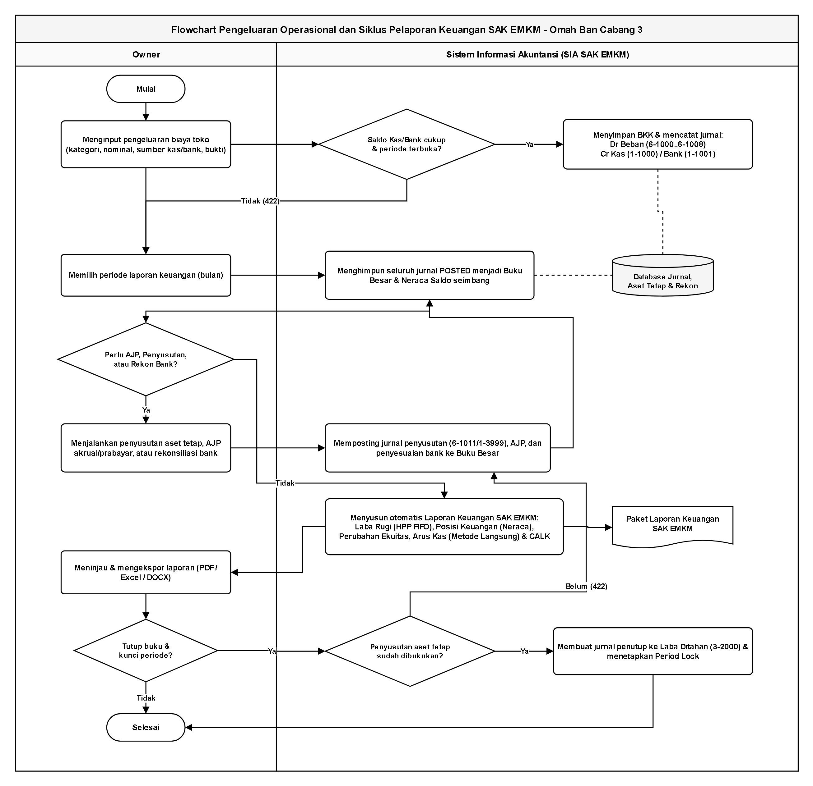
**Gambar 4.6 Flowchart Pengeluaran Operasional dan Siklus Pelaporan Keuangan SAK EMKM**
*Sumber: Peneliti (2026)*

Berdasarkan Gambar 4.6, pencatatan biaya operasional dimulai ketika Owner menginput pengeluaran toko (seperti gaji teknisi, listrik dan internet, sewa, perlengkapan bengkel, perawatan mesin spooring, atau konsumsi lembur), memilih metode pembayaran (Kas Laci `1-1000` atau Transfer Bank BCA `1-1001`), serta melampirkan foto bukti kuitansi. Server melalui `ExpenseService` dan `AccountingEngine` memeriksa apakah periode tanggal pengeluaran masih terbuka dan apakah saldo akun kas atau bank mencukupi setelah dikurangi pengeluaran tersebut. Apabila saldo tidak mencukupi (berpotensi negatif) atau periode telah terkunci, transaksi ditolak dengan kode `422`. Apabila valid, sistem menyimpan dokumen Bukti Kas Keluar (`BKK-YYYYMM-####`) dan memposting jurnal dengan mendebit akun beban yang bersangkutan (`6-1000` s.d. `6-1008`) serta mengkredit akun `1-1000` atau `1-1001`.

Ketika Owner membuka menu pelaporan keuangan pada suatu periode bulan, sistem menghimpun seluruh jurnal berstatus `POSTED` untuk menyusun Buku Besar dan Neraca Saldo. Sebelum menutup periode, Owner dapat memeriksa apakah diperlukan pembukuan penyusutan aset tetap bulanan (`DepreciationService`), ayat jurnal penyesuaian akrual atau beban dibayar di muka (`AdjustingEntryService`), maupun penyesuaian biaya administrasi dan jasa giro dari rekonsiliasi bank (`BankReconciliationService`). Setiap jurnal penyesuaian yang diposting langsung memperbarui saldo Buku Besar. Dari saldo buku besar tersebut, sistem menyusun secara otomatis paket laporan keuangan berstandar SAK EMKM yang terdiri atas Laporan Laba Rugi (dengan HPP FIFO), Laporan Posisi Keuangan (Neraca), Laporan Perubahan Ekuitas, Laporan Arus Kas metode langsung, serta Catatan atas Laporan Keuangan (CALK).

Apabila seluruh laporan pada bulan yang telah berakhir selesai ditinjau, Owner dapat menjalankan fitur Tutup Buku. Sistem terlebih dahulu memverifikasi bahwa tidak ada penyusutan aset tetap yang belum dibukukan pada bulan tersebut (`pendingTotal == 0`). Jika syarat terpenuhi, `PeriodClosingService` membentuk jurnal penutup (`PERIOD_CLOSING`) yang memindahkan saldo seluruh akun pendapatan dan beban ke akun `3-2000 Laba Ditahan Cabang 3`, lalu mencatat tanggal akhir bulan tersebut pada tabel `accounting_period_closings` sebagai batas `PeriodLock` sehingga data keuangan bulan yang telah ditutup tidak dapat diubah lagi oleh transaksi susulan.

### 4.1.4. Sequence Diagram

Sequence Diagram disusun untuk memperlihatkan urutan pertukaran pesan berdasarkan waktu antara aktor pengguna, antarmuka aplikasi React, layanan backend Laravel, mesin akuntansi dan FIFO, basis data MySQL, serta layanan eksternal Midtrans.

#### 4.1.4.1. Sequence Diagram Transaksi Point of Sale dan Pembayaran QRIS Midtrans

Gambar 4.7 menampilkan tujuh belas tahapan interaksi komponen pada saat kasir memproses penjualan ban baru dan jasa servis dengan pembayaran QRIS Dinamis Midtrans hingga struk tercetak.

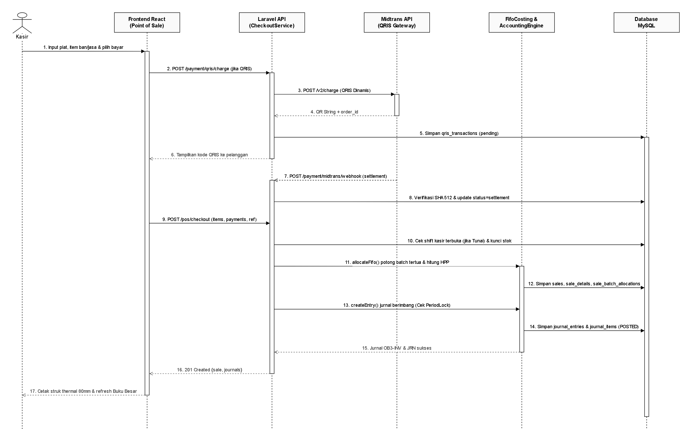
**Gambar 4.7 Sequence Diagram Transaksi Point of Sale dan Pembayaran QRIS Midtrans**
*Sumber: Peneliti (2026)*

Berdasarkan Gambar 4.7, interaksi diawali ketika Kasir memasukkan nomor plat kendaraan, memilih produk atau jasa, dan memilih metode pembayaran QRIS pada antarmuka React (pesan 1). Antarmuka mengirim permintaan `POST /payment/qris/charge` ke Laravel API (pesan 2), yang kemudian memanggil endpoint `/v2/charge` pada Midtrans API (pesan 3). Setelah Midtrans mengembalikan string QR beserta `order_id` (pesan 4), server mencatat transaksi berstatus `pending` ke tabel `qris_transactions` pada MySQL (pesan 5) dan menampilkan kode QRIS di layar kasir untuk dipindai pelanggan (pesan 6).

Ketika pelanggan menyelesaikan pembayaran melalui aplikasi perbankan atau dompet digital, server Midtrans mengirimkan notifikasi asinkron `POST /payment/midtrans/webhook` ke server toko (pesan 7). Server memverifikasi tanda tangan SHA-512 dan memperbarui status transaksi menjadi `settlement` pada database (pesan 8). Selanjutnya antarmuka React mengeksekusi `POST /pos/checkout` (pesan 9). Di dalam satu transaksi database, `CheckoutService` memverifikasi status shift kasir terbuka bila terdapat pembayaran tunai dan mengunci baris stok produk (pesan 10), memanggil `FifoCostingService::allocateFifo()` untuk memotong batch pembelian tertua serta menghitung HPP (pesan 11 dan 12), lalu memanggil `AccountingEngine::createEntry()` untuk memeriksa `PeriodLock` dan menyimpan jurnal penjualan berimbang berstatus `POSTED` ke tabel `journal_entries` dan `journal_items` (pesan 13 s.d. 15). Proses ditutup dengan pengembalian respons `201 Created` beserta objek nota dan jurnal (pesan 16) sehingga antarmuka kasir dapat langsung mencetak struk thermal 80mm dan memperbarui tampilan buku besar (pesan 17).

#### 4.1.4.2. Sequence Diagram Penerimaan Barang FIFO dan Pembayaran Utang Supplier

Gambar 4.8 menggambarkan urutan interaksi antara Staf Gudang saat menerima pengiriman ban baru dari distributor resmi dan Owner saat melunasi utang faktur tempo yang telah jatuh tempo.

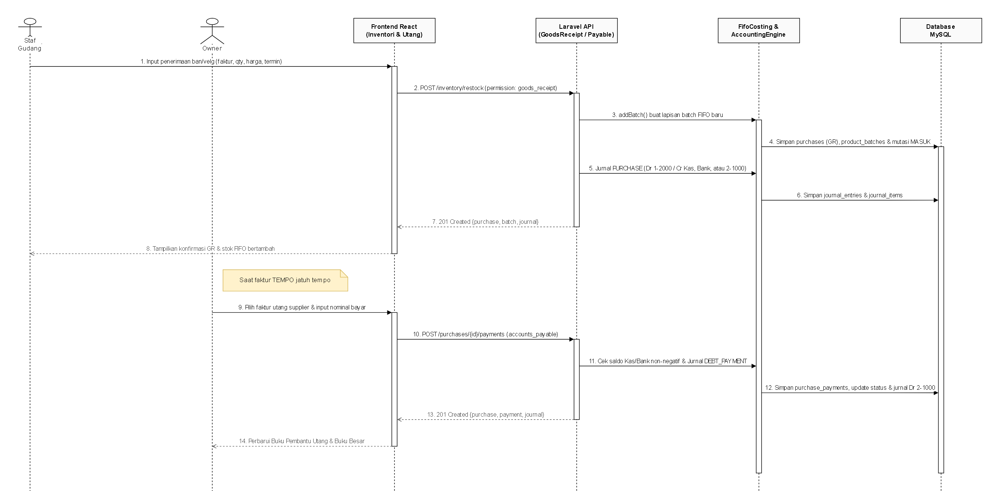
**Gambar 4.8 Sequence Diagram Penerimaan Barang FIFO dan Pembayaran Utang Supplier**
*Sumber: Peneliti (2026)*

Berdasarkan Gambar 4.8, alur pengadaan dimulai ketika Staf Gudang mengisi formulir penerimaan barang meliputi nomor faktur distributor, produk ban atau velg, kuantitas, total tagihan (termasuk kapitalisasi PPN masukan dari faktur supplier), serta termin pembayaran (pesan 1). Antarmuka mengirimkan permintaan `POST /inventory/restock` yang dilindungi izin `goods_receipt` (pesan 2). `GoodsReceiptService` memanggil `FifoCostingService::addBatch()` untuk membuat lapisan batch FIFO baru yang terhubung ke dokumen pembelian `GR-YYYYMM-####` (pesan 3), kemudian menyimpan baris `purchases`, `product_batches`, dan kartu stok `MASUK` ke MySQL (pesan 4). Pada saat bersamaan, sistem memanggil `AccountingEngine` untuk memposting jurnal `PURCHASE` dengan mendebit `1-2000 Persediaan Ban Baru Cabang 3` dan mengkredit `1-1000 Kas Laci` (untuk pembelian tunai), `1-1001 Bank BCA` (untuk transfer), atau `2-1000 Hutang Dagang Supplier` (untuk pembelian tempo) (pesan 5 s.d. 8).

Ketika faktur pembelian tempo telah mendekati atau memasuki tanggal jatuh tempo, Owner membuka tab Buku Pembantu Utang dan menginput nominal pelunasan beserta akun sumber dana (pesan 9). Antarmuka memanggil `POST /purchases/{id}/payments` dengan izin `accounts_payable` (pesan 10). `PayableService` mengunci baris faktur untuk mencegah kelebihan bayar, memverifikasi kecukupan saldo Kas atau Bank melalui `AccountingEngine` (pesan 11), menyimpan riwayat pembayaran pada tabel `purchase_payments`, memperbarui status faktur menjadi `SEBAGIAN` atau `LUNAS`, serta memposting jurnal `DEBT_PAYMENT` dengan mendebit `2-1000 Hutang Dagang Supplier` dan mengkredit `1-1000` atau `1-1001` (pesan 12 s.d. 14).

#### 4.1.4.3. Sequence Diagram Stock Opname dan Penyesuaian Nilai Persediaan

Gambar 4.9 merinci sebelas tahapan interaksi saat Staf Gudang mengirimkan hasil perhitungan fisik stok gudang hingga terbentuknya jurnal penyesuaian nilai persediaan.

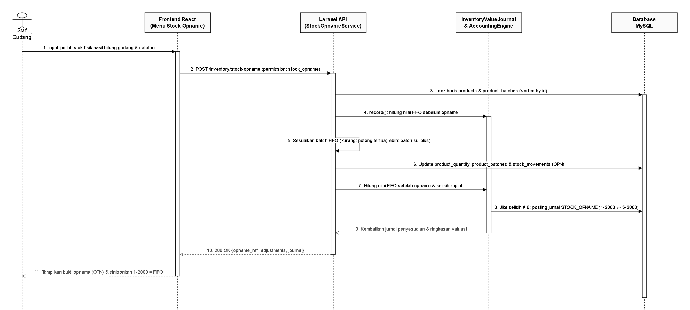
**Gambar 4.9 Sequence Diagram Stock Opname dan Penyesuaian Nilai Persediaan**
*Sumber: Peneliti (2026)*

Berdasarkan Gambar 4.9, setelah Staf Gudang menginput kuantitas fisik hasil perhitungan barang di gudang (pesan 1), antarmuka memanggil endpoint `POST /inventory/stock-opname` (pesan 2). `StockOpnameService` mengunci baris produk yang bersangkutan secara berurutan berdasarkan `id` untuk menghindari kondisi saling-kunci (deadlock) dengan transaksi kasir yang sedang berjalan (pesan 3). Layanan kemudian membuka pembungkus `InventoryValueJournal::record()` yang membaca nilai FIFO awal produk sebelum perubahan (pesan 4). Selanjutnya, sistem menyesuaikan lapisan `product_batches` agar total `remaining_qty` sama dengan jumlah fisik hasil opname, memperbarui `product_quantity`, dan menulis mutasi `PENYESUAIAN` bernomor `OPN-YYYYMM-####` ke MySQL (pesan 5 dan 6). `InventoryValueJournal` lalu menghitung nilai FIFO akhir dan memposting jurnal `STOCK_OPNAME` pada akun `1-2000` dan `5-2000` apabila terdapat selisih nilai rupiah (pesan 7 s.d. 11).

#### 4.1.4.4. Sequence Diagram Pelaporan Keuangan SAK EMKM dan Tutup Buku Periode

Gambar 4.10 menyajikan interaksi komponen saat Owner menjalankan penyusutan aset tetap, meninjau laporan keuangan SAK EMKM beserta CALK, hingga mengunci periode akuntansi bulanan.

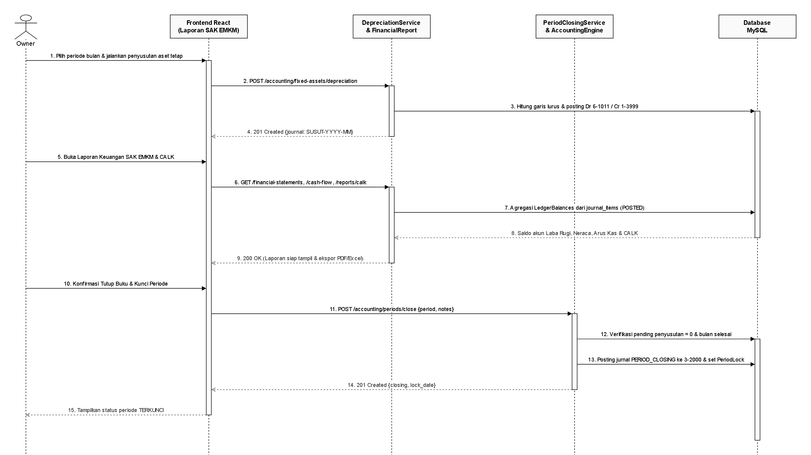
**Gambar 4.10 Sequence Diagram Pelaporan Keuangan SAK EMKM dan Tutup Buku Periode**
*Sumber: Peneliti (2026)*

Berdasarkan Gambar 4.10, pada akhir bulan Owner memilih periode laporan dan menjalankan penyusutan aset tetap melalui permintaan `POST /accounting/fixed-assets/depreciation` (pesan 1 dan 2). `DepreciationService` menghitung beban penyusutan metode garis lurus secara kumulatif dari harga perolehan dikurangi nilai residu dibagi masa manfaat bulan, lalu memposting jurnal `SUSUT-YYYY-MM` dengan mendebit `6-1011 Beban Penyusutan Aset Tetap` dan mengkredit `1-3999 Akumulasi Penyusutan Mesin` (pesan 3 dan 4).

Selanjutnya, saat Owner membuka layar Laporan Keuangan SAK EMKM (pesan 5), antarmuka memuat data secara paralel dari endpoint `/accounting/financial-statements`, `/accounting/cash-flow`, dan `/reports/calk` (pesan 6). Layanan pelaporan memanggil `LedgerBalances::forRange()` untuk melakukan agregasi saldo debit dan kredit dari tabel `journal_items` yang berstatus `POSTED` pada MySQL (pesan 7 dan 8), lalu mengembalikan struktur Laporan Laba Rugi, Laporan Posisi Keuangan, Perubahan Ekuitas, Laporan Arus Kas, dan Catatan atas Laporan Keuangan yang siap ditampilkan maupun diekspor ke PDF, Excel, atau DOCX (pesan 9). Setelah seluruh angka terverifikasi, Owner dapat mengeksekusi Tutup Buku melalui `POST /accounting/periods/close` (pesan 10 dan 11). `PeriodClosingService` memastikan tidak ada penyusutan tertunda dan bulan tersebut telah berakhir (pesan 12), memposting jurnal penutup `PERIOD_CLOSING` ke akun `3-2000 Laba Ditahan Cabang 3`, serta menyimpan tanggal penguncian pada `accounting_period_closings` (pesan 13 s.d. 15).

### 4.1.5. Entity Relationship Diagram (ERD) dan Bagan Akun Standar SAK EMKM

Perancangan basis data relasional disusun di atas MySQL 8 (`project-skripsi_ob`) untuk menjamin integritas referensial dan konsistensi transaksi pembukuan berpasangan. Gambar 4.11 menunjukkan Entity Relationship Diagram (ERD) dari seluruh tabel bisnis aktif yang digunakan dalam sistem Omah Ban Cabang 3.

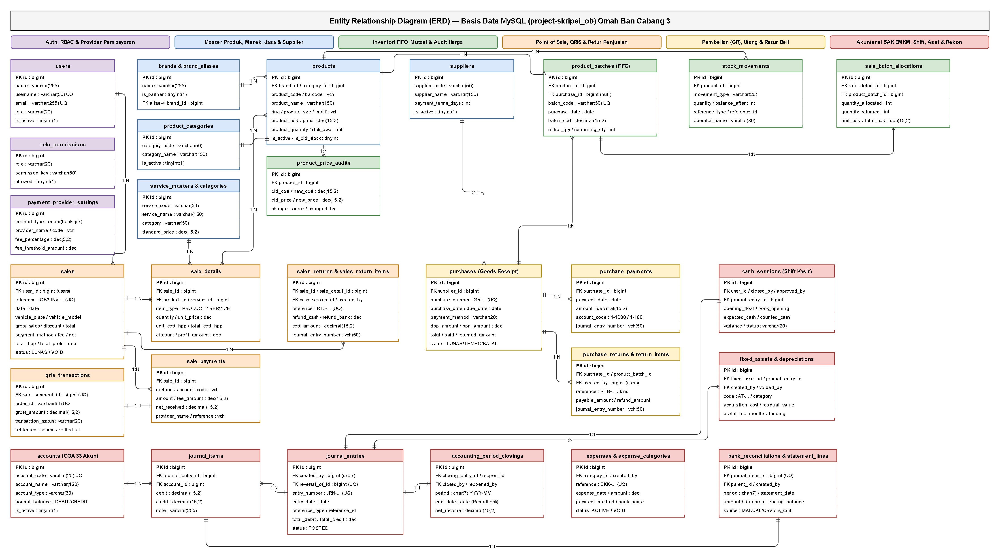
**Gambar 4.11 Entity Relationship Diagram (ERD) Basis Data `project-skripsi_ob`**
*Sumber: Peneliti (2026)*

Berdasarkan Gambar 4.11, struktur basis data dikelompokkan ke dalam enam domain fungsional yang saling berelasi:

1. Domain Autentikasi, RBAC, dan Pengaturan Pembayaran: Tabel `users` menyimpan akun pengguna beserta kolom `role` (`OWNER`, `KASIR`, `GUDANG`) dan status keaktifan `is_active`. Tabel `role_permissions` menyimpan matriks izin per kunci fitur (`permission_key` dan `allowed`), sedangkan tabel `payment_provider_settings` menyimpan daftar bank transfer dan penyedia QRIS beserta persentase tarif potongan MDR (`fee_percentage`) dan batas minimal pengenaan MDR (`fee_threshold_amount`).
2. Domain Master Katalog, Merek, Jasa, dan Supplier: Tabel `products` menyimpan atribut spesifik ban baru dan velg (seperti `product_code`, `barcode`, `brand_id`, `category_id`, `size_width`, `size_ratio`, `ring`, `product_size`, `motif`, `product_year`, `product_cost`, `product_price`, dan `product_quantity`) yang berelasi dengan `brands` (beserta `brand_aliases`) dan `product_categories`. Layanan bengkel disimpan pada tabel `service_masters` dan `service_categories`, sedangkan data distributor resmi beserta termin kredit bawaannya (`payment_terms_days`) disimpan pada tabel `suppliers`.
3. Domain Inventori FIFO, Mutasi, dan Audit Harga: Tabel `product_batches` merupakan inti perhitungan FIFO yang menyimpan setiap lapisan harga perolehan (`batch_code`, `purchase_date`, `batch_cost`, `initial_qty`, `remaining_qty`, dan kunci asing `purchase_id`). Setiap pergerakan barang masuk, keluar, maupun penyesuaian opname dicatat pada tabel `stock_movements` sebagai kartu stok, sedangkan jejak perubahan harga modal atau harga jual dicatat pada `product_price_audits`. Ketika terjadi penjualan di Point of Sale, tabel `sale_batch_allocations` mengikat baris item penjualan (`sale_detail_id`) dengan batch FIFO yang dikonsumsi (`product_batch_id`) beserta `quantity_allocated`, `quantity_returned`, dan `unit_cost`, sehingga retur penjualan maupun pembatalan nota (void) dapat mengembalikan stok persis ke lapisan batch asalnya.
4. Domain Point of Sale, QRIS Midtrans, dan Retur Penjualan: Tabel `sales` menyimpan header transaksi penjualan (`reference` berformat `OB3-INV-YYYYMM-####`, tanggal, identitas pelanggan, nomor plat kendaraan `vehicle_plate`, model kendaraan `vehicle_model`, `user_id` kasir, nilai kotor, diskon, nilai bersih, `total_hpp`, `total_profit`, dan status `LUNAS` atau `VOID`). Rincian item produk dan jasa disimpan pada `sale_details` (termasuk `unit_cost_hpp` dan `total_cost_hpp`), sedangkan rincian pembayaran disimpan pada `sale_payments` yang mendukung pembayaran tunggal maupun gabungan (split payment). Transaksi QRIS Dinamis Midtrans dicatat pada `qris_transactions` yang memiliki relasi satu-ke-satu (`1:1` unik) terhadap `sale_payments` melalui `sale_payment_id` untuk mencegah penggunaan ulang bukti bayar QRIS. Pengembalian barang dari pelanggan dicatat pada `sales_returns` (`RTJ-YYYYMM-####`) dan `sales_return_items` yang memisahkan pengembalian dana tunai (`refund_cash` dari laci kasir `1-1000`) dan pengembalian dana bank (`refund_bank` dari `1-1001`).
5. Domain Pembelian, Utang Supplier, dan Retur Pembelian: Tabel `purchases` menyimpan penerimaan barang (`GR-YYYYMM-####`), nomor faktur supplier, tanggal jatuh tempo (`due_date`), nilai DPP dan PPN masukan yang dikapitalisasi ke harga pokok persediaan, nominal terbayar (`paid_amount`), nominal diretur (`returned_amount`), serta status tagihan (`LUNAS`, `BELUM_LUNAS`, `SEBAGIAN`, atau `BATAL`). Riwayat angsuran atau pelunasan utang dicatat pada `purchase_payments`, sedangkan retur barang ke distributor atau pembatalan penerimaan barang dicatat pada `purchase_returns` (`RTB-YYYYMM-####`) dan `purchase_return_items`.
6. Domain Akuntansi SAK EMKM, Shift Kasir, Aset Tetap, dan Rekonsiliasi Bank: Tabel `accounts` menyimpan 33 akun bagan akun standar (Chart of Accounts). Setiap peristiwa ekonomi di seluruh modul menghasilkan header jurnal pada `journal_entries` (`JRN-YYYYMM-####`) dan minimal dua baris rincian debit/kredit pada `journal_items` yang wajib memenuhi persamaan $\sum \text{debit} = \sum \text{credit}$ hingga satuan sen. Penguncian periode tutup buku disimpan pada `accounting_period_closings`, pencatatan beban operasional harian disimpan pada `expenses` (`BKK-YYYYMM-####`) dan `expense_categories`, shift kas laci disimpan pada `cash_sessions`, sub-buku besar aset tetap dan penyusutan bulanan disimpan pada `fixed_assets` (`AT-YYYYMM-####`) dan `fixed_asset_depreciations`, serta pencocokan mutasi rekening Bank BCA disimpan pada `bank_reconciliations` dan `bank_statement_lines`.

Sebagai dasar klasifikasi penjurnalan dan penyusunan laporan keuangan SAK EMKM, sistem menggunakan 33 akun pada tabel `accounts` yang disajikan pada Tabel 4.2. Mengingat Omah Ban Cabang 3 merupakan usaha non-Pengusaha Kena Pajak (non-PKP), tidak terdapat akun PPN Keluaran pada penjualan; PPN dari faktur distributor dikapitalisasi langsung ke dalam harga perolehan batch persediaan (`1-2000`).

**Tabel 4.2 Bagan Akun Standar (Chart of Accounts) SAK EMKM Omah Ban Cabang 3**

| Kode Akun | Nama Akun | Kelompok Akun | Saldo Normal | Keterangan Penggunaan dalam Sistem |
|---|---|---|---|---|
| `1-1000` | Kas Toko Laci Kasir | ASET | Debit | Kas fisik di laci kasir; dikendalikan melalui shift kasir (`cash_sessions`) |
| `1-1001` | Bank BCA Cabang 3 | ASET | Debit | Rekening bank penampung transfer pelanggan, penyelesaian QRIS, dan pembayaran bank |
| `1-1002` | Piutang Dagang | ASET | Debit | Nonaktif sejak penghapusan penjualan kredit (seluruh penjualan dibayar lunas) |
| `1-1100` | Beban Dibayar di Muka | ASET | Debit | Aset lancar untuk jurnal penyesuaian beban prabayar (`PREPAID`) |
| `1-2000` | Persediaan Ban Baru Cabang 3 | ASET | Debit | Akun kontrol persediaan FIFO; saldonya wajib sama dengan $\sum (\text{remaining\_qty} \times \text{batch\_cost})$ |
| `1-3000` | Peralatan Bengkel & Mesin Spooring | ASET | Debit | Akun kontrol harga perolehan aset tetap; hanya diposting melalui register aset tetap |
| `1-3999` | Akumulasi Penyusutan Mesin | ASET (Kontra) | Kredit | Akun kontra-aset tetap atas penyusutan bulanan metode garis lurus |
| `2-1000` | Hutang Dagang Supplier | LIABILITAS | Kredit | Akun kontrol utang pembelian ban/velg tempo (`TEMPO`) kepada distributor resmi |
| `2-1004` | Uang Muka Pelanggan (DP Booking) | LIABILITAS | Kredit | Nonaktif sejak penghapusan fitur inden DP; disimpan untuk histori jurnal |
| `2-1100` | Beban Yang Masih Harus Dibayar | LIABILITAS | Kredit | Liabilitas jangka pendek untuk jurnal penyesuaian beban akrual (`ACCRUAL`) |
| `3-1000` | Modal Disetor Pemilik | EKUITAS | Kredit | Modal awal pemilik, saldo awal persediaan, dan tambahan setoran modal |
| `3-2000` | Laba Ditahan Cabang 3 | EKUITAS | Kredit | Akumulasi laba bersih dari jurnal penutup periode (`PERIOD_CLOSING`) |
| `3-3000` | Prive Pemilik | EKUITAS (Kontra) | Debit | Pengambilan dana kas atau bank oleh pemilik toko untuk keperluan pribadi |
| `4-1000` | Pendapatan Penjualan Ban Baru | PENDAPATAN | Kredit | Pendapatan kotor atas penjualan produk fisik ban baru dan velg di Point of Sale |
| `4-1001` | Pendapatan Jasa Servis & Spooring | PENDAPATAN | Kredit | Pendapatan kotor atas layanan jasa pasang, balancing, spooring, dan jasa manual |
| `4-2000` | Pendapatan Surcharge EDC | PENDAPATAN | Kredit | Nonaktif sejak penghapusan mesin kartu EDC |
| `4-3000` | Pendapatan Bunga Bank | PENDAPATAN | Kredit | Pendapatan jasa giro atau bunga bank dari hasil rekonsiliasi Bank BCA |
| `4-9000` | Potongan Diskon Penjualan | PENDAPATAN (Kontra) | Debit | Pengurang pendapatan atas diskon per item maupun diskon total nota penjualan |
| `4-9100` | Retur Penjualan | PENDAPATAN (Kontra) | Debit | Pengurang pendapatan atas pengembalian barang dari pelanggan (`RTJ`) |
| `5-1000` | Harga Pokok Penjualan (HPP) Ban Baru | BEBAN | Debit | Beban pokok ban dan velg yang terjual berdasarkan alokasi batch FIFO tertua |
| `5-2000` | Selisih Persediaan (Opname) | BEBAN | Debit | Penampung selisih naik atau turun nilai persediaan hasil stock opname dan rekonsiliasi |
| `6-1000` | Beban Gaji & Upah Teknisi | BEBAN | Debit | Beban gaji pokok karyawan dan upah montir/teknisi bengkel |
| `6-1001` | Beban Listrik, Air & Internet | BEBAN | Debit | Beban utilitas bulanan operasional toko dan bengkel |
| `6-1003` | Beban Sewa Tempat Toko | BEBAN | Debit | Beban sewa bangunan toko dan area bengkel Cabang 3 |
| `6-1004` | Beban Transportasi & Pengiriman | BEBAN | Debit | Beban bahan bakar dan pengiriman operasional toko |
| `6-1005` | Beban Perlengkapan & ATK | BEBAN | Debit | Beban alat tulis kantor, kertas thermal struk, timbel balancing, dan bahan habis pakai |
| `6-1006` | Beban Perawatan Mesin Spooring | BEBAN | Debit | Beban kalibrasi dan pemeliharaan peralatan bengkel serta kompresor |
| `6-1007` | Beban Konsumsi & Lembur | BEBAN | Debit | Beban konsumsi staf dan uang lembur pelayanan bengkel |
| `6-1008` | Beban Pajak & Retribusi | BEBAN | Debit | Beban pajak daerah, retribusi, dan pembayaran PPh Final UMKM saat dibayarkan |
| `6-1009` | Beban MDR QRIS & EDC | BEBAN | Debit | Beban potongan biaya layanan Merchant Discount Rate atas transaksi QRIS |
| `6-1010` | Selisih Kas Kasir (Lebih/Kurang) | BEBAN | Debit | Selisih perhitungan uang fisik laci kasir saat penutupan shift disetujui Owner |
| `6-1011` | Beban Penyusutan Aset Tetap | BEBAN | Debit | Beban penyusutan bulanan peralatan bengkel dan inventaris toko |
| `6-1012` | Beban Administrasi Bank | BEBAN | Debit | Beban biaya administrasi bulanan rekening Bank BCA dari rekonsiliasi bank |

*Sumber: Peneliti (2026)*

---

## 4.2. Hasil Implementasi dan Tampilan Website

Tahap konstruksi (*Construction*) pada metode RAD menghasilkan aplikasi berbasis website yang menggabungkan antarmuka Point of Sale dengan Sistem Informasi Akuntansi berstandar SAK EMKM. Antarmuka dibangun menggunakan React 19, TypeScript, dan Tailwind CSS v4 dengan tata letak responsif serta navigasi atas (`HeaderNavbar`) yang menyesuaikan daftar menu berdasarkan hak akses pengguna yang sedang masuk. Di bagian header juga ditampilkan indikator status koneksi server dan basis data (`project-skripsi_ob`), indikator jumlah stok menipis, lonceng notifikasi operasional, serta chip saldo buku Kas Laci (`1-1000`) khusus bagi peran yang memiliki hak baca kas. Berikut adalah hasil implementasi tampilan dari setiap halaman dan modul utama sistem.

### 4.2.1. Halaman Login dan Autentikasi Pengguna

Halaman Login merupakan gerbang pengamanan pertama sebelum pengguna dapat mengakses fitur operasional maupun pembukuan. Pada halaman ini, pengguna memasukkan nama pengguna (`username`) atau alamat email beserta kata sandi yang terdaftar, lalu menekan tombol masuk untuk menjalankan proses autentikasi Sanctum. Apabila kredensial yang dimasukkan tidak valid atau melebihi batas lima kali percobaan gagal dalam satu menit, sistem menampilkan pemberitahuan kesalahan dalam bahasa Indonesia.

> **[TEMPAT FOTO / SCREENSHOT: Gambar 4.12]**
> *Cara ambil foto:* Buka `http://localhost:3000` dalam keadaan belum login (`LoginScreen.tsx`). Pastikan kartu login, kolom input Username/Email dan Password, serta identitas Toko Ban dan Velg Omah Ban Cabang 3 terlihat jelas.

**Gambar 4.12 Halaman Login Sistem Omah Ban Cabang 3**
*Sumber: Peneliti (2026)*

Sebagaimana ditunjukkan pada Gambar 4.12, halaman login dirancang fokus pada fungsi verifikasi identitas. Setelah autentikasi berhasil, sistem secara otomatis mengarahkan pengguna ke halaman utama sesuai perannya: akun Kasir diarahkan langsung ke layar Point of Sale agar siap melayani pelanggan, akun Staf Gudang diarahkan ke layar Produk & Jasa untuk mengelola persediaan, dan akun Owner diarahkan ke layar Dashboard Ringkasan Bisnis.

### 4.2.2. Halaman Dashboard Ringkasan Bisnis Pemilik

Halaman Dashboard (`ExecutiveDashboardScreen`) dirancang khusus bagi Owner (izin `dashboard`) untuk memantau kinerja keuangan dan persediaan toko secara langsung tanpa perlu menunggu rekapitulasi manual di malam hari. Angka-angka keuangan pada dashboard ini tidak dihitung dari memori lokal peramban, melainkan diambil langsung dari agregasi jurnal berstatus `POSTED` di server melalui endpoint `GET /api/v1/reports/daily-recap` dan valuasi FIFO dari `GET /api/v1/inventory/valuation`.

> **[TEMPAT FOTO / SCREENSHOT: Gambar 4.13]**
> *Cara ambil foto:* Login sebagai `owner@omahban.com`, lalu buka menu **Dashboard**. Tampilkan kartu ringkasan KPI (Pendapatan Bersih, Laba Kotor/Bersih, Jumlah Transaksi, Nilai Persediaan FIFO, Saldo Kas Laci & Bank BCA), grafik tren pendapatan 7 hari terakhir, serta daftar produk ban terlaris dan peringatan stok kritis.

**Gambar 4.13 Halaman Dashboard Ringkasan Bisnis Pemilik**
*Sumber: Peneliti (2026)*

Berdasarkan Gambar 4.13, dashboard menyajikan kartu indikator kinerja utama (KPI) yang mencakup total pendapatan bersih bulan berjalan, laba bersih setelah HPP FIFO dan beban operasional, posisi saldo Kas Laci (`1-1000`) dan Bank BCA (`1-1001`), serta total nilai persediaan ban baru berdasarkan lapisan batch FIFO aktif. Di bawah kartu ringkasan terdapat grafik tren penjualan harian, komposisi metode pembayaran (Tunai, Transfer Bank, dan QRIS), daftar produk ban dengan perputaran tertinggi, serta panel peringatan dini untuk ban yang jumlah stoknya telah menyentuh batas stok minimum (`product_stock_alert`).

### 4.2.3. Halaman Point of Sale (POS) dan Shift Kasir

Halaman Point of Sale (`PosScreen`) merupakan antarmuka utama kasir di bagian depan toko yang diakses menggunakan izin `pos`. Halaman ini ditampilkan dalam mode layar penuh dua kolom (split-screen) untuk memaksimalkan kecepatan pencarian produk ban baru, velg, dan jasa servis di meja kasir.

#### 4.2.3.1. Tampilan Utama Halaman Point of Sale

Pada sisi kiri layar Point of Sale ditampilkan katalog produk dan jasa yang dilengkapi kolom pencarian instan (berdasarkan nama ban, kode barang, ukuran ring, atau pemindaian barcode) serta tombol penyaring kategori (Ban Mobil, Ban Dalam, Ban Truk, Velg, dan Jasa Servis). Setiap kartu produk menampilkan informasi merek, ukuran ring, tahun produksi, sisa stok, dan harga jual. Produk yang harga jualnya masih bernilai Rp 0 diberi penanda khusus dan dicegah oleh sistem agar tidak dapat dimasukkan ke transaksi sebelum harganya dilengkapi.

> **[TEMPAT FOTO / SCREENSHOT: Gambar 4.14]**
> *Cara ambil foto:* Buka layar **Point of Sale** (`PosScreen.tsx`). Tampilkan halaman penuh yang memperlihatkan header kontrol shift kasir di atas, grid kartu katalog ban baru & jasa di sisi kiri, serta panel keranjang belanja di sisi kanan.

**Gambar 4.14 Tampilan Utama Halaman Point of Sale**
*Sumber: Peneliti (2026)*

#### 4.2.3.2. Kontrol Buka dan Tutup Shift Kasir

Sebagai wujud pengendalian fisik atas uang tunai di laci kasir (`1-1000`), bagian header Point of Sale dilengkapi komponen `CashShiftControl` (izin `cash_session`). Sebelum kasir dapat memproses pembayaran tunai pertama pada hari tersebut, kasir wajib membuka shift dengan memasukkan jumlah uang modal awal laci (`opening_float`). Apabila jumlah uang awal berbeda dari saldo buku akun `1-1000`, sistem mewajibkan pengisian catatan penjelasan (`opening_note`).

> **[TEMPAT FOTO / SCREENSHOT: Gambar 4.15]**
> *Cara ambil foto:* Klik tombol status **Shift Kasir** pada header Point of Sale (`CashShiftControl.tsx`). Ambil tangkapan layar modal **Buka Shift Kasir** atau **Tutup Shift Kasir** yang menampilkan perbandingan saldo kas diharapkan (*expected cash*), input perhitungan uang fisik (*counted cash*), dan kolom alasan selisih (*variance reason*).

**Gambar 4.15 Modal Kontrol Buka dan Tutup Shift Kasir**
*Sumber: Peneliti (2026)*

Sebagaimana terlihat pada Gambar 4.15, saat jam operasional berakhir, kasir menekan tombol Tutup Shift dan memasukkan jumlah uang tunai fisik yang dihitung di laci (`counted_cash`). Sistem secara otomatis menghitung kas yang seharusnya ada di laci berdasarkan rumus modal awal ditambah seluruh penerimaan penjualan tunai dikurangi pengeluaran tunai dan refund retur tunai selama rentang jurnal shift tersebut. Jika terdapat selisih antara perhitungan fisik dan catatan sistem, kasir wajib menuliskan alasan selisih, dan sesi tersebut masuk ke antrean `PENDING_APPROVAL` untuk diverifikasi oleh Owner.

#### 4.2.3.3. Pengelolaan Keranjang Belanja, Input Nomor Plat, dan Diskon Item

Pada panel keranjang belanja di sisi kanan, kasir mencatat nama pelanggan dan nomor plat kendaraan (`vehicle_plate`) beserta model mobil yang diservis. Pencatatan nomor plat kendaraan ini memudahkan penelusuran riwayat penggantian ban atau servis spooring pelanggan di kemudian hari. Kasir dapat mengubah kuantitas barang, memberikan potongan diskon per item melalui modal `CartLineEditModal`, memberikan diskon nota secara keseluruhan, atau memarkir pesanan sementara (*parked orders*) apabila mobil pelanggan masih dalam proses pengerjaan di area bengkel.

> **[TEMPAT FOTO / SCREENSHOT: Gambar 4.16]**
> *Cara ambil foto:* Pada layar Point of Sale, masukkan 1 atau 2 produk ban dan jasa spooring ke keranjang, isi kolom **Nomor Plat Kendaraan** (misal `AA 1234 XY`), lalu klik salah satu baris item di keranjang hingga terbuka modal ubah kuantitas/diskon item (`CartLineEditModal.tsx`).

**Gambar 4.16 Panel Keranjang Belanja, Input Nomor Plat, dan Modal Potongan Harga Item**
*Sumber: Peneliti (2026)*

#### 4.2.3.4. Form Tambah Jasa Servis Manual

Untuk mengantisipasi jasa pengerjaan bengkel khusus yang tarifnya menyesuaikan tingkat kesulitan di lapangan, halaman Point of Sale menyediakan fitur Input Manual (`ManualItemForm`). Demi menjaga keakuratan nilai persediaan FIFO pada akun `1-2000`, sistem membatasi fitur input manual ini khusus untuk kategori jasa servis (`SERVICE`). Barang dagangan fisik berupa ban dan velg tidak diizinkan diinput secara manual tanpa melalui katalog dan penerimaan barang (`Goods Receipt`), karena setiap barang fisik wajib memiliki lapisan harga modal batch FIFO.

> **[TEMPAT FOTO / SCREENSHOT: Gambar 4.17]**
> *Cara ambil foto:* Pada layar Point of Sale, buka form **Tambah Jasa Manual** (`ManualItemForm.tsx`), tampilkan kolom nama jasa servis dan tarif jasa.

**Gambar 4.17 Form Tambah Jasa Servis Manual pada Point of Sale**
*Sumber: Peneliti (2026)*

#### 4.2.3.5. Modal Pembayaran Multi-Metode (Tunai, Transfer Bank, dan Split Payment)

Ketika kasir menekan tombol Bayar, sistem menampilkan `CheckoutModal` yang memuat daftar penyedia pembayaran aktif dari server (`GET /api/v1/pos/payment-options`). Sistem mendukung pembayaran penuh menggunakan satu metode (Tunai, Transfer Bank BCA, atau QRIS) maupun pembayaran gabungan (*split payment*, misalnya sebagian dibayar tunai dan sisanya melalui transfer bank atau QRIS). Pada pembayaran tunai, sistem menghitung uang kembalian secara otomatis, sedangkan pada pembayaran QRIS sistem menampilkan pratinjau potongan biaya MDR sesuai tarif yang berlaku pada `payment_provider_settings`.

> **[TEMPAT FOTO / SCREENSHOT: Gambar 4.18]**
> *Cara ambil foto:* Klik tombol **Bayar** di keranjang Point of Sale untuk membuka `CheckoutModal.tsx`. Tampilkan pilihan metode pembayaran (Tunai, Transfer Bank, QRIS), input nominal uang diterima, perhitungan kembalian, atau mode *Split Payment*.

**Gambar 4.18 Modal Pembayaran Transaksi Point of Sale (Tunai, Transfer, dan Split)**
*Sumber: Peneliti (2026)*

#### 4.2.3.6. Modal Pembayaran QRIS Dinamis Midtrans

Apabila pelanggan memilih pembayaran QRIS Dinamis, sistem membuka `QrisDynamicModal` yang memanggil API Midtrans untuk menghasilkan kode QR sesuai total tagihan nota. Selama modal terbuka, antarmuka melakukan pemeriksaan status penyelesaian pembayaran ke server setiap 2,5 detik hingga Midtrans mengirimkan status `settlement` melalui webhook atau API status. Pada lingkungan uji coba (*sandbox*), modal ini juga menyediakan tombol simulasi pelunasan apabila variabel `MIDTRANS_ALLOW_SIMULATION` diaktifkan.

> **[TEMPAT FOTO / SCREENSHOT: Gambar 4.19]**
> *Cara ambil foto:* Pada `CheckoutModal`, pilih metode **QRIS** dan klik tampilkan QRIS Dinamis hingga muncul `QrisDynamicModal.tsx` yang menampilkan gambar QR Code Midtrans, `order_id`, nominal tagihan, dan indikator status menunggu pembayaran / berhasil.

**Gambar 4.19 Modal Pembayaran QRIS Dinamis Midtrans**
*Sumber: Peneliti (2026)*

#### 4.2.3.7. Modal Transaksi Berhasil dan Pratinjau Struk Thermal 80mm / Faktur A4

Begitu transaksi dinyatakan valid oleh server dan jurnal penjualan selesai diposting ke buku besar, sistem menampilkan `PosSuccessModal` beserta nomor referensi nota resmi (`OB3-INV-YYYYMM-####`). Kasir dapat langsung mencetak bukti pembayaran dalam dua pilihan format melalui `ReceiptPreviewModal`, yaitu format struk kasir thermal ukuran 80mm untuk printer kasir atau format faktur ukuran A4.

> **[TEMPAT FOTO / SCREENSHOT: Gambar 4.20]**
> *Cara ambil foto:* Selesaikan satu transaksi di Point of Sale hingga muncul `PosSuccessModal.tsx` dan buka `ReceiptPreviewModal.tsx` yang menampilkan desain struk belanja thermal 80mm lengkap dengan identitas Omah Ban Cabang 3, nomor plat kendaraan, rincian ban/jasa, metode bayar, dan uang kembalian.

**Gambar 4.20 Modal Transaksi Berhasil dan Pratinjau Struk Thermal 80mm**
*Sumber: Peneliti (2026)*

### 4.2.4. Halaman Riwayat Struk, Pembatalan (Void), dan Retur Penjualan

Menu Riwayat Struk (`ThermalReceiptScreen`) menyediakan pusat penelusuran dan audit atas seluruh nota penjualan yang pernah dicatat di Point of Sale. Pengguna dengan izin `receipt` dapat mencari nota berdasarkan nomor referensi `OB3-INV-...`, nama pelanggan, nomor plat kendaraan, maupun rentang tanggal transaksi, serta mencetak ulang struk kapan saja.

> **[TEMPAT FOTO / SCREENSHOT: Gambar 4.21]**
> *Cara ambil foto:* Buka menu **Riwayat Struk** (`ThermalReceiptScreen.tsx`). Tampilkan daftar histori transaksi di sisi kiri dan rincian nota lengkap (beserta informasi jurnal otomatis atau tombol Cetak Ulang, Retur, dan Void) di sisi kanan.

**Gambar 4.21 Halaman Riwayat Struk dan Detail Nota Penjualan**
*Sumber: Peneliti (2026)*

Untuk menangani koreksi transaksi penjualan tanpa merusak keseimbangan buku besar, halaman ini menyediakan dua mekanisme koreksi yang dikendalikan sesuai hak akses:

1. Pembatalan Nota Penjualan (*Void*, izin `sale_void` khusus Owner): Apabila terjadi kesalahan penginputan pada hari berjalan dan nota belum pernah memiliki retur, Owner dapat membatalkan nota dengan wajib menginput alasan pembatalan minimal lima karakter. Layanan `SaleVoidService` secara otomatis mengembalikan seluruh kuantitas ban yang terjual ke lapisan batch FIFO asalnya berdasarkan tabel `sale_batch_allocations`, mencatat mutasi stok masuk (`SALE_VOID`), mengubah status nota menjadi `VOID`, serta memposting jurnal pembalik (`POS_SALE_VOID`) yang merupakan cerminan terbalik dari jurnal penjualan aslinya.
2. Retur Penjualan Parsial (izin `sales_return`, modal `SalesReturnModal`): Apabila pelanggan mengembalikan sebagian atau seluruh barang yang telah dibeli, pengguna memilih item dan kuantitas yang diretur beserta alasannya (untuk pengguna non-Owner dibatasi maksimal nota berusia 30 hari). Layanan `SalesReturnService` menghitung nominal pengembalian uang secara proporsional setelah diskon nota dan membaginya mengikuti komposisi pembayaran nota asal: porsi pembayaran tunai dikembalikan dari Kas Laci (`1-1000`, mewajibkan shift kasir terbuka), sedangkan porsi transfer atau QRIS dikembalikan dari Bank BCA (`1-1001`). Stok ban dikembalikan ke lapisan batch FIFO yang terpakai dan sistem memposting jurnal `SALES_RETURN` (`RTJ-YYYYMM-####`) dengan mendebit `4-9100 Retur Penjualan` dan mengkredit `1-1000` atau `1-1001`, serta mendebit `1-2000 Persediaan Ban Baru` dan mengkredit `5-1000 HPP Ban Baru` sebesar harga modal batch yang kembali.

> **[TEMPAT FOTO / SCREENSHOT: Gambar 4.22]**
> *Cara ambil foto:* Pada halaman Riwayat Struk, klik tombol **Retur** pada salah satu nota lunas untuk menampilkan `SalesReturnModal.tsx` (terlihat pilihan item yang diretur, kuantitas retur, perhitungan nominal refund kas/bank, dan kolom alasan retur).

**Gambar 4.22 Modal Retur Penjualan Parsial**
*Sumber: Peneliti (2026)*

### 4.2.5. Halaman Manajemen Produk, Jasa, dan Persediaan FIFO

Menu Produk & Jasa (`InventoryScreen`) merupakan pusat pengelolaan master katalog dan pengendalian fisik persediaan metode FIFO yang diakses oleh Staf Gudang dan Owner (`inventory_view` dan `inventory_manage`). Di bagian atas halaman ditampilkan spanduk valuasi persediaan dari server (`GET /api/v1/inventory/valuation`) yang membandingkan total nilai lapisan batch FIFO ($\sum \text{remaining\_qty} \times \text{batch\_cost}$) dengan saldo buku besar akun `1-2000 Persediaan Ban Baru Cabang 3` untuk memastikan keduanya selalu selaras (selisih Rp 0). Modul ini terdiri atas enam sub-tab terintegrasi.

#### 4.2.5.1. Sub-tab Katalog Produk Ban Baru dan Rincian Lapisan Batch FIFO

Sub-tab Katalog menampilkan daftar seluruh ban baru, ban dalam, ban truk, dan velg beserta atribut ukuran, ring, merek, tahun produksi, harga modal terakhir, harga jual, dan jumlah stok tersedia. Ketika pengguna membuka rincian salah satu produk, komponen `ProductFifoBatchList` menampilkan daftar lapisan batch FIFO aktif yang diurutkan dari tanggal pembelian paling tua ke paling muda, lengkap dengan kode batch, nama supplier, tanggal masuk, harga modal per unit (`batch_cost`), kuantitas awal, dan sisa kuantitas (`remaining_qty`).

> **[TEMPAT FOTO / SCREENSHOT: Gambar 4.23]**
> *Cara ambil foto:* Buka menu **Produk & Jasa** sub-tab **Katalog** (`InventoryScreen.tsx`), lalu buka tampilan rincian lapisan batch FIFO pada salah satu produk ban (`ProductFifoBatchList.tsx`) agar terlihat antrean batch FIFO-nya.

**Gambar 4.23 Halaman Katalog Produk Ban Baru dan Rincian Lapisan Batch FIFO**
*Sumber: Peneliti (2026)*

#### 4.2.5.2. Modal Tambah dan Ubah Data Produk

Melalui `ProductFormModal`, Staf Gudang dapat mendaftarkan produk ban atau velg baru dengan mengisi nama barang, merek, kategori, spesifikasi ukuran (lebar, rasio, dan diameter ring seperti `185/65 R15`), motif tapak ban, tahun produksi, harga modal, harga jual, batas peringatan stok minimum, serta stok awal bila ada. Kode produk (`PRD-...`) dan nomor barcode (`899...`) dapat diisi manual atau dibuatkan otomatis oleh server.

> **[TEMPAT FOTO / SCREENSHOT: Gambar 4.24]**
> *Cara ambil foto:* Pada sub-tab Katalog, klik tombol **Tambah Produk** hingga tampil `ProductFormModal.tsx` yang memperlihatkan kolom spesifikasi ban (lebar, rasio, ring, motif, tahun), harga modal, dan harga jual.

**Gambar 4.24 Modal Tambah dan Ubah Data Produk Ban / Velg**
*Sumber: Peneliti (2026)*

#### 4.2.5.3. Sub-tab Buku Stok Bulanan FIFO

Sub-tab Buku Stok Bulanan FIFO (`StockMonthlyLedgerView`) menyajikan tampilan berbentuk lembar kerja (*spreadsheet*) bulanan per merek yang biasa digunakan oleh pemilik Omah Ban untuk memeriksa mutasi barang. Tabel ini merinci stok awal bulan, barang masuk bersih (*Masuk neto*, yaitu penerimaan barang ditambah retur penjualan dikurangi retur pembelian), rincian penjualan harian dari tanggal 1 sampai akhir bulan, sisa stok akhir, serta lapisan harga modal FIFO dan fitur ekspor langsung ke file Excel (`.xlsx`) maupun CSV.

> **[TEMPAT FOTO / SCREENSHOT: Gambar 4.25]**
> *Cara ambil foto:* Pada menu **Produk & Jasa**, klik sub-tab **Buku Stok Bulanan FIFO** (`StockMonthlyLedgerView.tsx`). Tampilkan tabel matriks mutasi harian per produk ban beserta filter bulan/merek dan tombol Ekspor Excel.

**Gambar 4.25 Halaman Buku Stok Bulanan FIFO**
*Sumber: Peneliti (2026)*

#### 4.2.5.4. Sub-tab Kategori Produk dan Master Jasa Servis

Sub-tab Kategori (`CategoryManagementView`) dan sub-tab Jasa (`ServiceManagementView`) digunakan untuk memelihara pengelompokan produk serta daftar layanan bengkel seperti Jasa Pasang Ban, Balancing Roda, Spooring 3D, dan Tambal Tubeless. Untuk menjaga keutuhan riwayat transaksi, produk, kategori, maupun jasa yang sudah pernah tercatat dalam transaksi penjualan atau mutasi stok tidak akan dihapus secara fisik dari database, melainkan dinonaktifkan (`is_active = false`) apabila pengguna menekan tombol hapus.

> **[TEMPAT FOTO / SCREENSHOT: Gambar 4.26]**
> *Cara ambil foto:* Pada menu **Produk & Jasa**, klik sub-tab **Kategori** (`CategoryManagementView.tsx`) untuk menampilkan daftar kategori produk ban dan velg.

**Gambar 4.26 Halaman Manajemen Kategori Produk**
*Sumber: Peneliti (2026)*

> **[TEMPAT FOTO / SCREENSHOT: Gambar 4.27]**
> *Cara ambil foto:* Pada menu **Produk & Jasa**, klik sub-tab **Jasa Servis** (`ServiceManagementView.tsx`) beserta modal `ServiceFormModal.tsx` yang menampilkan daftar layanan spooring dan balancing.

**Gambar 4.27 Halaman Master Jasa Servis dan Spooring**
*Sumber: Peneliti (2026)*

#### 4.2.5.5. Sub-tab Penerimaan Barang, Kartu Stok, Retur Pembelian, dan Stock Opname

Sub-tab Penerimaan & Stok Opname merupakan pusat operasional gudang untuk mencatat seluruh mutasi fisik persediaan beserta kartu stok (`StockCardDrawer`). Setiap produk memiliki Kartu Stok digital yang mencatat tanggal, jenis mutasi (`MASUK`, `KELUAR`, atau `PENYESUAIAN`), nomor referensi dokumen (`GR`, `OB3-INV`, `RTJ`, `RTB`, atau `OPN`), jumlah perubahan, saldo stok setelah mutasi (`balance_after`), serta nama petugas operator.

> **[TEMPAT FOTO / SCREENSHOT: Gambar 4.28]**
> *Cara ambil foto:* Buka sub-tab **Penerimaan & Stok Opname** atau klik tombol **Kartu Stok** pada salah satu ban hingga terbuka `StockCardDrawer.tsx` yang menampilkan histori mutasi keluar-masuk barang dan saldo berjalan.

**Gambar 4.28 Halaman Mutasi Stok dan Drawer Kartu Stok Produk**
*Sumber: Peneliti (2026)*

Ketika kiriman ban baru dari distributor tiba di toko, Staf Gudang membuka `GoodsReceiptModal` (izin `goods_receipt`). Petugas memilih nama supplier, nomor faktur distributor, produk yang diterima, kuantitas, nilai DPP dan PPN faktur (yang dikapitalisasi langsung ke dalam harga modal batch), serta metode pembayaran (`TUNAI`, `TRANSFER_BCA`, atau kredit `TEMPO` beserta tanggal jatuh temponya). Begitu disimpan, sistem menerbitkan dokumen `GR-YYYYMM-####`, membentuk lapisan batch FIFO baru, dan memposting jurnal pembelian ke buku besar.

> **[TEMPAT FOTO / SCREENSHOT: Gambar 4.29]**
> *Cara ambil foto:* Klik tombol **Terima Barang (Goods Receipt)** untuk menampilkan `GoodsReceiptModal.tsx` lengkap dengan pilihan supplier, nomor faktur, input kuantitas, harga beli/total faktur (DPP + PPN), dan pilihan termin `TUNAI` / `TRANSFER_BCA` / `TEMPO`.

**Gambar 4.29 Modal Penerimaan Barang Distributor (Goods Receipt)**
*Sumber: Peneliti (2026)*

Apabila terdapat ban yang cacat produksi atau kesalahan penginputan faktur penerimaan barang, Staf Gudang dapat membuka `PurchaseReturnModal` (izin `purchase_return`). Sistem menyediakan dua pilihan tindakan: Retur Pembelian Parsial (`RETURN`, hanya untuk unit yang masih tersisa di dalam batch penerimaan tersebut dan belum terjual) yang otomatis memotong saldo utang supplier (`2-1000`) atau mencatat pengembalian kas/bank (`1-1000`/`1-1001`), serta Pembatalan Penerimaan Barang (`CANCEL`, khusus untuk dokumen `GR` yang belum tersentuh penjualan maupun pembayaran utang) yang membalik jurnal pembelian asal secara utuh.

> **[TEMPAT FOTO / SCREENSHOT: Gambar 4.30]**
> *Cara ambil foto:* Pada daftar riwayat penerimaan barang, klik tombol **Retur / Batal Penerimaan** hingga muncul `PurchaseReturnModal.tsx`.

**Gambar 4.30 Modal Retur Pembelian dan Pembatalan Penerimaan Barang**
*Sumber: Peneliti (2026)*

Untuk pemeriksaan fisik berkala, Staf Gudang membuka `StockOpnameModal` (izin `stock_opname`). Petugas memasukkan hasil hitung fisik gudang, dan sistem langsung menampilkan selisih kuantitas terhadap stok buku serta memposting jurnal penyesuaian nilai persediaan FIFO ke akun `1-2000` dan `5-2000`. Selain opname rutin, modul ini juga dilengkapi fitur Rekonsiliasi dan Impor Excel (`StockReconciliationModal`) yang digunakan satu kali pada masa migrasi awal sebelum pembukuan persediaan dinyatakan *go-live* melalui saldo awal persediaan (`OPENING_BALANCE`).

> **[TEMPAT FOTO / SCREENSHOT: Gambar 4.31]**
> *Cara ambil foto:* Klik tombol **Stock Opname** untuk menampilkan `StockOpnameModal.tsx` (atau bukti hasil opname `StockOpnameReceiptView.tsx`) yang memperlihatkan perbandingan stok sistem, input stok fisik, dan selisih opname.

**Gambar 4.31 Modal Pemeriksaan Fisik Barang (Stock Opname)**
*Sumber: Peneliti (2026)*

#### 4.2.5.6. Sub-tab Data Rekanan Distributor (Supplier)

Sub-tab Supplier beserta `SupplierFormModal` digunakan untuk mengelola data mitra distributor ban dan velg resmi, mencakup kode supplier, nama perusahaan distributor, nomor telepon, alamat, nama kontak sales, serta termin jatuh tempo kredit bawaan (default 30 hari) yang otomatis mengisi tanggal jatuh tempo saat pencatatan pembelian tempo.

> **[TEMPAT FOTO / SCREENSHOT: Gambar 4.32]**
> *Cara ambil foto:* Pada menu **Produk & Jasa**, buka sub-tab **Supplier** dan tampilkan daftar distributor beserta `SupplierFormModal.tsx`.

**Gambar 4.32 Halaman Data Rekanan Distributor (Supplier)**
*Sumber: Peneliti (2026)*

### 4.2.6. Halaman Pengeluaran Biaya Operasional (Expenses)

Menu Biaya Toko (`ExpensesScreen`, izin `expenses`) dirancang untuk menggantikan kebiasaan pengambilan uang kasir tanpa catatan dengan pencatatan Bukti Kas Keluar (`BKK-YYYYMM-####`) yang langsung terjurnal secara berpasangan. Di bagian atas halaman ditampilkan posisi saldo buku Kas Laci (`1-1000`) dan Bank BCA (`1-1001`) hari ini (`GET /api/v1/accounting/cash-balances`) serta kartu analitik komposisi pengeluaran (`ExpenseAnalyticsCard`).

> **[TEMPAT FOTO / SCREENSHOT: Gambar 4.33]**
> *Cara ambil foto:* Buka menu **Biaya Toko** (`ExpensesScreen.tsx`). Tampilkan bagian atas halaman yang memuat saldo Kas Laci & Bank BCA serta formulir input pengeluaran (`ExpenseForm.tsx`) lengkap dengan pilihan 8 kategori beban SAK EMKM, nominal, metode bayar (Kas Laci / Transfer Bank), nama penerima, dan unggah bukti kuitansi.

**Gambar 4.33 Form Pencatatan Pengeluaran Biaya Operasional Toko**
*Sumber: Peneliti (2026)*

Berdasarkan Gambar 4.33, setiap kategori pengeluaran pada `ExpenseForm` telah dipetakan ke kode akun beban standar SAK EMKM pada tabel `expense_categories` (`6-1000` Gaji & Upah, `6-1001` Listrik/Air/Internet, `6-1003` Sewa, `6-1004` Transportasi, `6-1005` Perlengkapan/ATK, `6-1006` Perawatan Mesin Spooring, `6-1007` Konsumsi/Lembur, dan `6-1008` Pajak/Retribusi). Ketika pengeluaran disimpan, sistem memeriksa kecukupan saldo sumber dana yang dipilih; apabila jumlah pengeluaran melebihi saldo Kas Laci atau Bank BCA yang tersedia pada tanggal tersebut, server menolak transaksi (`422`) untuk mencegah saldo kas negatif.

Di bagian bawah halaman disajikan tabel riwayat pengeluaran (`ExpenseTable`) yang dilengkapi penyaring periode tanggal, kategori, dan status (`ACTIVE` atau `VOID`). Pengguna dapat membuka rincian lampiran foto nota (`ExpenseDetailModal`), mencetak voucher Bukti Kas Keluar resmi (`ExpenseVoucherModal`), atau membatalkan pengeluaran yang salah input (`void`) yang secara otomatis membentuk jurnal pembalik `VOID_EXPENSE`.

> **[TEMPAT FOTO / SCREENSHOT: Gambar 4.34]**
> *Cara ambil foto:* Pada halaman **Biaya Toko**, tampilkan tabel daftar pengeluaran (`ExpenseTable.tsx`) dan klik salah satu baris untuk membuka modal voucher Bukti Kas Keluar (`ExpenseVoucherModal.tsx`).

**Gambar 4.34 Tabel Riwayat Pengeluaran dan Bukti Kas Keluar (BKK)**
*Sumber: Peneliti (2026)*

### 4.2.7. Halaman Pusat Akuntansi SAK EMKM (Buku Besar)

Menu Buku Besar (`GeneralLedgerScreen`) merupakan pusat pengolahan dan pengawasan akuntansi yang terdiri atas delapan tab terpadu: (1) Jurnal Umum, (2) Buku Besar, (3) Neraca Saldo, (4) Pembantu Hutang, (5) Laporan Keuangan, (6) Kas & Bank, (7) Aset Tetap, dan (8) Rekonsiliasi Bank. Setiap tab dilindungi oleh fungsi `isTabAllowed` sehingga hanya menampilkan tab yang sesuai dengan kunci izin pengguna.

#### 4.2.7.1. Tab Jurnal Umum dan Modal Jurnal Manual

Tab Jurnal Umum (`JournalTab`, izin `accounting_hub`) menyajikan daftar seluruh ayat jurnal berstatus `POSTED` (`JRN-YYYYMM-####`) yang terbentuk dari seluruh aktivitas toko. Pengguna dapat menyaring jurnal berdasarkan rentang tanggal, kode akun, pencarian kata kunci, maupun kelompok sumber transaksi (Penjualan POS, Pembelian & Utang, Pengeluaran Biaya, Persediaan & Opname, Kas & Modal, Aset Tetap, AJP Akrual/Prabayar, Rekonsiliasi Bank, dan Tutup Buku).

Untuk transaksi non-operasional di luar modul otomatis, Owner dapat membuat Jurnal Manual melalui `ManualJournalModal`. Sebagai pengendalian internal agar buku pembantu tidak berselisih dengan buku besar, sistem melarang jurnal manual memposting langsung ke enam akun kontrol (`1-1002 Piutang`, `1-2000 Persediaan Ban Baru`, `2-1000 Hutang Dagang Supplier`, `2-1004 Uang Muka`, `1-3000 Peralatan Bengkel`, dan `1-3999 Akumulasi Penyusutan`). Setiap jurnal manual wajib seimbang ($\sum \text{Debit} = \sum \text{Kredit}$) dan dapat dibalik satu kali menggunakan tombol Pembalik (*Reverse*) yang menghasilkan jurnal `MANUAL_REVERSAL`.

> **[TEMPAT FOTO / SCREENSHOT: Gambar 4.35]**
> *Cara ambil foto:* Buka menu **Buku Besar** tab **Jurnal Umum** (`JournalTab.tsx`). Tampilkan daftar jurnal berpasangan Debit/Kredit beserta filter sumber jurnal, dan tampilkan pula modal input **Jurnal Manual** (`ManualJournalModal.tsx`).

**Gambar 4.35 Halaman Jurnal Umum dan Modal Input Jurnal Manual**
*Sumber: Peneliti (2026)*

#### 4.2.7.2. Modal Jurnal Penyesuaian (AJP Akrual dan Prabayar)

Pada akhir periode, Owner dapat mencatat Ayat Jurnal Penyesuaian (AJP) melalui tombol **AJP Akrual / Dibayar di Muka** (`AdjustingEntryModal`). Sistem menyediakan dua jenis penyesuaian standar SAK EMKM:
1. Beban Akrual (`ACCRUAL`): Mencatat beban yang telah terjadi pada bulan berjalan namun baru akan dibayar pada bulan berikutnya (misalnya tagihan listrik atau gaji akhir bulan) dengan mendebit akun beban (`6-xxxx`) dan mengkredit `2-1100 Beban Yang Masih Harus Dibayar`. Pilihan *Auto-Reverse* memungkinkan sistem langsung membuat jurnal pembalik otomatis (`ADJUSTING_REVERSAL`) tertanggal 1 bulan berikutnya.
2. Beban Dibayar di Muka (`PREPAID`): Mengakui porsi beban bulan berjalan atas pembayaran di muka dengan mendebit akun beban (`6-xxxx`) dan mengkredit `1-1100 Beban Dibayar di Muka`.

> **[TEMPAT FOTO / SCREENSHOT: Gambar 4.36]**
> *Cara ambil foto:* Di bagian header menu **Buku Besar**, klik tombol **AJP Akrual / Dibayar di Muka** hingga tampil `AdjustingEntryModal.tsx`.

**Gambar 4.36 Modal Jurnal Penyesuaian (AJP Akrual dan Prabayar)**
*Sumber: Peneliti (2026)*

#### 4.2.7.3. Tab Buku Besar per Akun (General Ledger)

Tab Buku Besar (`GeneralLedgerTab`) menampilkan rincian mutasi debit, kredit, dan saldo berjalan (*running balance*) untuk masing-masing dari 33 akun COA pada rentang periode yang dipilih. Tabel ini juga menampilkan saldo awal akun sebelum tanggal awal periode (`opening balance`) dan menyediakan tombol cetak serta ekspor ke PDF, Excel, DOCX, dan CSV (`LedgerPrintModal`).

> **[TEMPAT FOTO / SCREENSHOT: Gambar 4.37]**
> *Cara ambil foto:* Pada menu **Buku Besar**, klik tab **Buku Besar** (`GeneralLedgerTab.tsx`). Pilih akun `1-1000 Kas Toko Laci Kasir` atau `1-2000 Persediaan Ban Baru Cabang 3` agar terlihat saldo awal, daftar mutasi jurnal, dan saldo akhir berjalan.

**Gambar 4.37 Halaman Buku Besar per Akun (General Ledger)**
*Sumber: Peneliti (2026)*

#### 4.2.7.4. Tab Neraca Saldo Seimbang (Trial Balance)

Tab Neraca Saldo (`TrialBalanceTab`) merangkum saldo akhir seluruh akun per tanggal posisi yang dipilih (`as_of`), dikelompokkan ke dalam kolom Debit dan Kredit sesuai saldo normal masing-masing akun. Di bagian bawah tabel ditampilkan baris validasi keseimbangan yang memastikan total kolom Debit sama persis dengan total kolom Kredit (`SEIMBANG`).

> **[TEMPAT FOTO / SCREENSHOT: Gambar 4.38]**
> *Cara ambil foto:* Pada menu **Buku Besar**, klik tab **Neraca Saldo** (`TrialBalanceTab.tsx`). Pastikan tabel 33 akun dan baris total Debit = Kredit (`Seimbang`) terlihat utuh.

**Gambar 4.38 Halaman Neraca Saldo Seimbang (Trial Balance)**
*Sumber: Peneliti (2026)*

#### 4.2.7.5. Tab Buku Pembantu Utang Supplier dan Pelunasan Utang

Tab Pembantu Hutang (`AccountsPayableTab`, izin `accounts_payable`) menyajikan daftar seluruh faktur pembelian tempo (`GR-YYYYMM-####`) kepada distributor resmi beserta informasi tanggal faktur, tanggal jatuh tempo (`due_date`), nilai tagihan awal, nilai potongan retur pembelian, jumlah yang telah dibayar, sisa utang berjalan, serta indikator peringatan faktur yang akan atau telah melewati jatuh tempo. Ketika Owner menekan tombol Bayar pada suatu faktur, modal `PayDebtModal` terbuka untuk memilih tanggal bayar, nominal angsuran atau pelunasan penuh, serta sumber dana (`1-1000 Kas Laci` atau `1-1001 Bank BCA`), yang langsung memposting jurnal `DEBT_PAYMENT` (Debit `2-1000` / Kredit `1-1000` atau `1-1001`).

> **[TEMPAT FOTO / SCREENSHOT: Gambar 4.39]**
> *Cara ambil foto:* Pada menu **Buku Besar**, klik tab **Pembantu Hutang** (`AccountsPayableTab.tsx`) dan buka modal pembayaran utang (`PayDebtModal.tsx`).

**Gambar 4.39 Halaman Buku Pembantu Utang Supplier dan Modal Pembayaran Utang**
*Sumber: Peneliti (2026)*

#### 4.2.7.6. Tab Kas & Bank (Persetujuan Shift Kasir, Setor Bank, Prive, dan Modal)

Tab Kas & Bank (`CashBankTab`, izin `cash_session_approve` dan `cash_movement`) memusatkan dua fungsi pengendalian kas bagi Owner:
1. Persetujuan Tutup Shift Kasir: Menampilkan daftar sesi shift kasir yang berstatus `PENDING_APPROVAL` lengkap dengan rincian modal awal, mutasi kas masuk/keluar selama shift, kas diharapkan (*expected*), kas fisik terhitung (*counted*), dan nilai selisih (*variance*). Saat Owner menekan tombol Setujui (*Approve*), sistem membukukan selisih kas ke akun `6-1010 Selisih Kas Kasir` sehingga saldo buku `1-1000` kembali sama dengan uang fisik di laci.
2. Mutasi Kas dan Ekuitas Pemilik: Menyediakan formulir pencatatan tiga transaksi kas khusus dengan nomor referensi `KAS-YYYYMM-####`, yaitu Setoran Kas Laci ke Bank BCA (`DEPOSIT`: Debit `1-1001` / Kredit `1-1000`), Pengambilan Prive Pemilik (`DRAWING`: Debit `3-3000 Prive Pemilik` / Kredit `1-1000` atau `1-1001`), serta Tambahan Setoran Modal Pemilik (`CAPITAL`: Debit `1-1000` atau `1-1001` / Kredit `3-1000 Modal Disetor Pemilik`).

> **[TEMPAT FOTO / SCREENSHOT: Gambar 4.40]**
> *Cara ambil foto:* Pada menu **Buku Besar**, klik tab **Kas & Bank** (`CashBankTab.tsx`). Tampilkan daftar persetujuan shift kasir serta form mutasi Setor Bank, Prive Pemilik, dan Setoran Modal.

**Gambar 4.40 Halaman Kas & Bank (Approval Shift Kasir, Setor Bank, Prive, Modal)**
*Sumber: Peneliti (2026)*

#### 4.2.7.7. Tab Register Aset Tetap dan Penyusutan Bulanan

Tab Aset Tetap (`FixedAssetsTab` dan `FixedAssetModal`, izin `fixed_assets`) berfungsi sebagai sub-buku besar untuk akun kontrol `1-3000 Peralatan Bengkel & Mesin Spooring` dan `1-3999 Akumulasi Penyusutan Mesin`. Di bagian atas tab ditampilkan kartu rekonsiliasi yang membandingkan total nilai perolehan dan akumulasi penyusutan pada register aset tetap dengan saldo buku besar akun `1-3000` dan `1-3999` (menampilkan status `Cocok` saat selisih Rp 0). Owner dapat mendaftarkan aset baru (`AT-YYYYMM-####`) dengan sumber pendanaan Tunai (`1-1000`), Transfer Bank (`1-1001`), Setoran Modal Barang (`MODAL`), atau Saldo Awal (`OPENING`), menentukan harga perolehan, nilai residu, dan umur manfaat bulan, serta mengeksekusi tombol **Jalankan Penyusutan Bulan Ini** yang otomatis menghitung penyusutan garis lurus dan memposting jurnal `SUSUT-YYYY-MM` (Debit `6-1011` / Kredit `1-3999`).

> **[TEMPAT FOTO / SCREENSHOT: Gambar 4.41]**
> *Cara ambil foto:* Pada menu **Buku Besar**, klik tab **Aset Tetap** (`FixedAssetsTab.tsx`). Tampilkan tabel daftar mesin spooring/inventaris bengkel, panel penyusutan bulanan, serta modal tambah aset tetap (`FixedAssetModal.tsx`).

**Gambar 4.41 Halaman Register Aset Tetap dan Eksekusi Penyusutan Bulanan**
*Sumber: Peneliti (2026)*

#### 4.2.7.8. Tab Rekonsiliasi Bank BCA

Tab Rekonsiliasi Bank (`BankReconciliationTab`, izin `bank_reconciliation`) memudahkan Owner mencocokkan catatan buku besar akun `1-1001 Bank BCA Cabang 3` dengan rekening koran bank setiap bulan. Owner dapat menginput baris mutasi bank secara manual atau mengimpor file CSV rekening koran (`tanggal,keterangan,jumlah`), memasukkan saldo akhir rekening koran, lalu menjalankan fitur **Auto-Match** yang mencocokkan mutasi bank dengan baris jurnal buku besar yang bernominal dan berarah sama dalam rentang waktu tiga hari. Untuk pencairan gabungan satu kali dari Midtrans atas beberapa transaksi QRIS harian, tersedia fitur **Group Match** yang memecah satu baris kredit rekening koran untuk dicocokkan dengan beberapa jurnal penjualan QRIS sekaligus. Baris biaya administrasi bank atau pendapatan bunga bank yang belum tercatat di buku besar dapat langsung dibukukan dari layar ini menggunakan tombol **Bukukan Bunga / Biaya Admin** (`BANK_RECON_ADJUSTMENT` ke akun `6-1012` atau `4-3000`) hingga status rekonsiliasi menunjukkan `Terekonsiliasi` (selisih Rp 0).

> **[TEMPAT FOTO / SCREENSHOT: Gambar 4.42]**
> *Cara ambil foto:* Pada menu **Buku Besar**, klik tab **Rekonsiliasi Bank** (`BankReconciliationTab.tsx`). Tampilkan ringkasan perbandingan saldo buku `1-1001` vs saldo rekening koran BCA, daftar baris mutasi yang sudah/belum cocok, serta tombol Impor CSV dan Auto-Match.

**Gambar 4.42 Halaman Rekonsiliasi Bank BCA**
*Sumber: Peneliti (2026)*

#### 4.2.7.9. Modal Saldo Awal Akun dan Tutup Buku Periode

Di bagian header menu Buku Besar terdapat dua tombol kontrol periode bagi Owner:
1. Tombol **Saldo Awal** (`OpeningBalanceModal`): Digunakan satu kali saat inisialisasi pembukuan (*go-live*) untuk memasukkan saldo awal akun Kas Laci (`1-1000`), Bank BCA (`1-1001`), Peralatan Bengkel (`1-3000`), Akumulasi Penyusutan (`1-3999`), dan Laba Ditahan (`3-2000`) dengan penyeimbang otomatis ke akun `3-1000 Modal Disetor Pemilik` (`ACCOUNT_OPENING`).
2. Tombol **Tutup Buku** (`PeriodClosingModal`): Digunakan untuk menutup periode bulan yang telah berakhir. Sistem menampilkan tanggal kunci periode saat ini (`lock_date`), daftar riwayat bulan yang telah ditutup, serta tombol eksekusi tutup buku yang memposting jurnal `PERIOD_CLOSING` ke akun `3-2000` dan mengunci seluruh transaksi pada bulan tersebut. Apabila diperlukan koreksi mendesak, Owner dapat membuka kembali periode terakhir yang ditutup (*Reopen*) dengan wajib mencantumkan alasan pembukaan kembali.

> **[TEMPAT FOTO / SCREENSHOT: Gambar 4.43]**
> *Cara ambil foto:* Di header menu **Buku Besar**, klik tombol **Tutup Buku** (`PeriodClosingModal.tsx`) dan/atau **Saldo Awal** (`OpeningBalanceModal.tsx`).

**Gambar 4.43 Modal Saldo Awal Akun dan Modal Tutup Buku Periode**
*Sumber: Peneliti (2026)*

### 4.2.8. Halaman Laporan Keuangan SAK EMKM dan CALK

Menu Laporan Keuangan (`FinancialStatementsScreen` dan `SakEmkmReportTab`, izin `financial_reports`) menyajikan hasil akhir pengolahan Sistem Informasi Akuntansi yang disusun secara langsung dari jurnal-jurnal berstatus `POSTED`. Di bagian atas layar ditampilkan empat kartu ringkasan eksekutif (Pendapatan Bersih, Laba/Rugi Bersih beserta persentase margin, Kas & Bank Akhir Periode, serta status keseimbangan Posisi Keuangan), pemilih periode bulan/kuartal/tahun (`PeriodPicker`), dan menu ekspor terpadu (`ExportMenu`) yang mendukung pengunduhan paket lengkap laporan keuangan SAK EMKM dalam format PDF ber-kop resmi toko, Excel (`.xlsx`), maupun Word (`.docx`).

> **[TEMPAT FOTO / SCREENSHOT: Gambar 4.44]**
> *Cara ambil foto:* Buka menu **Laporan Keuangan** (`FinancialStatementsScreen.tsx`). Ambil tangkapan layar yang memperlihatkan kartu KPI di atas beserta tampilan sub-tab **1. Laba Rugi**, **2. Posisi Keuangan (Neraca)**, **3. Perubahan Ekuitas**, **4. Arus Kas**, dan **5. CALK** (dapat digabung atau ditampilkan sub-tab utamanya).

**Gambar 4.44 Halaman Laporan Keuangan SAK EMKM (Laba Rugi, Posisi Keuangan, Perubahan Ekuitas, Arus Kas, dan CALK)**
*Sumber: Peneliti (2026)*

Sebagaimana terlihat pada Gambar 4.44, halaman ini menyediakan lima sub-tab laporan keuangan resmi:
1. Laporan Laba Rugi: Menyajikan Pendapatan Usaha (`4-1000` Penjualan Ban Baru dan `4-1001` Jasa Servis), dikurangi akun kontra-pendapatan (`4-9000` Potongan Diskon dan `4-9100` Retur Penjualan) menjadi Pendapatan Bersih, dikurangi Harga Pokok Penjualan FIFO (`5-1000` dan `5-2000`) menjadi Laba Kotor, dikurangi rincian Beban Operasional (`6-1000` s.d. `6-1012`), serta ditambah Pendapatan Lain-lain (`4-3000` Bunga Bank) hingga menghasilkan Laba (Rugi) Bersih periode berjalan.
2. Laporan Posisi Keuangan (Neraca): Menyajikan posisi Aset Lancar (`1-1000` Kas Laci, `1-1001` Bank BCA, `1-1100` Beban Dibayar di Muka, dan `1-2000` Persediaan Ban Baru FIFO) serta Aset Tetap (`1-3000` dikurangi `1-3999`) di sisi kiri, yang diseimbangkan secara otomatis terhadap Liabilitas (`2-1000` Hutang Dagang Supplier dan `2-1100` Beban Akrual) dan Ekuitas (`3-1000` Modal Disetor, `3-2000` Laba Ditahan ditambah laba bersih periode berjalan yang belum ditutup, dikurangi `3-3000` Prive Pemilik) di sisi kanan.
3. Laporan Perubahan Ekuitas: Merinci saldo ekuitas awal periode, tambahan setoran modal pemilik, laba bersih periode berjalan, pengurangan prive pemilik, hingga saldo ekuitas akhir periode.
4. Laporan Arus Kas (`CashFlowStatementTab`): Menggunakan metode langsung (*direct method*) yang mengelompokkan seluruh mutasi kas dan bank (`1-1000` + `1-1001`) ke dalam arus kas dari aktivitas operasi (penerimaan dari pelanggan, pembayaran kepada supplier, pembayaran beban operasional, dan kas operasi lainnya), aktivitas investasi (perolehan aset tetap peralatan bengkel), serta aktivitas pendanaan (setoran modal dan penarikan prive pemilik), lengkap dengan rekonsiliasi saldo kas awal ke saldo kas akhir periode.
5. Catatan atas Laporan Keuangan (`CalkView`): Menyajikan informasi umum entitas Omah Ban Cabang 3, pernyataan kepatuhan terhadap SAK EMKM, tujuh ikhtisar kebijakan akuntansi penting (dasar penyusunan akrual, kas dan bank, persediaan metode FIFO, aset tetap dan penyusutan garis lurus, pengakuan pendapatan, beban akrual/prabayar, serta kebijakan perpajakan PPh Final UMKM PP 55 Tahun 2022 sebesar 0,5%), diikuti rincian pos-pos laporan keuangan (rincian kas dan status rekonsiliasi bank, rincian nilai persediaan FIFO per kategori, rincian register aset tetap, rincian saldo utang per supplier distributor, dan rincian ekuitas).

### 4.2.9. Halaman Laporan Operasional Harian

Menu Laporan Harian (`DailyReportsScreen`, izin `daily_reports`) dirancang untuk menggantikan proses pencocokan nota global dan nota kuning yang sebelumnya menyita waktu 1 sampai 2 jam setiap malam. Halaman ini memiliki dua tab laporan yang bersumber dari layanan `DailyReportService`:
1. Tab Kas Harian (`GET /api/v1/reports/daily-cash`): Menampilkan posisi saldo awal, kas masuk, kas keluar, dan saldo akhir hari tersebut pada akun Kas Laci (`1-1000`) dan Bank BCA (`1-1001`), rincian mutasi kas per jenis jurnal, daftar seluruh nota penjualan hari tersebut, rekapitulasi penjualan per petugas kasir, daftar pengeluaran biaya harian, serta riwayat sesi shift kasir. Apabila diakses oleh akun Kasir (tanpa izin `financial_reports`), server secara otomatis membatasi data (`scope: "cashier"`) sehingga kasir hanya dapat melihat daftar nota, rekap penjualan, dan sesi shift miliknya sendiri tanpa menampilkan nilai HPP maupun laba toko.
2. Tab Rekap Harian (`GET /api/v1/reports/daily-recap`, khusus pengguna dengan izin `dashboard` atau `financial_reports`): Menyajikan tabel rekapitulasi harian dalam rentang tanggal (maksimal 92 hari) yang memuat jumlah nota, kuantitas ban terjual, pendapatan barang dan jasa, diskon, retur penjualan, pendapatan bersih, HPP FIFO, laba kotor, beban operasional, laba bersih, serta rincian bauran pembayaran (*payment mix*: Tunai, Transfer Bank, dan QRIS). Jumlah total baris pada tabel Rekap Harian ini selalu sama persis dengan angka Laporan Laba Rugi pada rentang tanggal yang sama.

> **[TEMPAT FOTO / SCREENSHOT: Gambar 4.45]**
> *Cara ambil foto:* Buka menu **Laporan Harian** (`DailyReportsScreen.tsx`). Tampilkan tab **Kas Harian** (rekap per kasir, posisi kas laci/bank, dan daftar nota harian) serta tab **Rekap Harian**.

**Gambar 4.45 Halaman Laporan Operasional Harian (Kas Harian dan Rekap Harian)**
*Sumber: Peneliti (2026)*

### 4.2.10. Halaman Pengaturan Sistem, Provider Pembayaran, dan Hak Akses (RBAC)

Menu Pengaturan (`SettingsScreen`, izin `role_settings`) memungkinkan Owner menyesuaikan konfigurasi operasional toko melalui lima sub-tab:
1. Profil Identitas Toko (`profile`) dan Format Struk & Faktur (`invoice`): Mengatur nama cabang, alamat, nomor telepon, teks catatan kaki struk thermal 80mm, serta kop dokumen ekspor laporan.
2. Metode Pembayaran (`PaymentMethodsTab`): Mengelola daftar rekening bank transfer dan penyedia QRIS pada server (`/api/v1/settings/payment-providers`), termasuk pengaturan persentase biaya potongan MDR QRIS (`fee_percentage`) dan batas minimal transaksi bebas MDR (`fee_threshold_amount`).
3. Parameter Akuntansi (`accounting`): Menampilkan informasi pemetaan akun standar SAK EMKM yang digunakan oleh mesin penjurnalan otomatis.
4. Peran & Hak Akses (`RolePermissionsTab`, khusus `OWNER`): Menyajikan matriks sakelar (*toggle matrix*) untuk mengatur 21 kunci izin (`PermissionKey`) pada peran `KASIR` dan `GUDANG` secara langsung ke tabel `role_permissions` di server (`PUT /api/v1/settings/role-permissions`). Peran `OWNER` dikunci selalu memiliki akses penuh agar pemilik toko tidak kehilangan kendali atas sistem.

> **[TEMPAT FOTO / SCREENSHOT: Gambar 4.46]**
> *Cara ambil foto:* Buka menu **Pengaturan** (`SettingsScreen.tsx`). Tampilkan sub-tab **Metode Pembayaran** (`PaymentMethodsTab.tsx` yang memuat tarif MDR QRIS & Bank) serta sub-tab **Peran & Hak Akses** (`RolePermissionsTab.tsx` yang memuat matriks hak akses Kasir dan Staf Gudang).

**Gambar 4.46 Halaman Pengaturan Sistem, Provider Pembayaran QRIS/Bank, dan Matriks Hak Akses (RBAC)**
*Sumber: Peneliti (2026)*

---

## 4.3. Pengujian dan Evaluasi Sistem

Setelah tahap konstruksi selesai, sistem diuji pada tahap peralihan (*Cutover / Implementation*) menggunakan dua pendekatan sebagaimana dirancang pada Subbab 3.6, yaitu pengujian fungsionalitas dengan metode *Black-Box Testing* dan evaluasi penerimaan pengguna melalui wawancara mendalam bersama ketiga informan penelitian.

### 4.3.1. Pengujian Fungsionalitas (Black-Box Testing)

Pengujian *Black-Box Testing* dilakukan dengan memberikan skenario masukan data (*input*), baik berupa data transaksi normal (*positive test case*) maupun data yang melanggar aturan bisnis dan pengendalian internal (*negative test case*), pada setiap modul untuk memeriksa apakah keluaran (*output*) sistem telah sesuai dengan kaidah operasional dan akuntansi SAK EMKM. Hasil pengujian dirinci ke dalam lima tabel per modul (Tabel 4.3 sampai dengan Tabel 4.7) dan dirangkum pada Tabel 4.8.

**Tabel 4.3 Pengujian Black-Box Modul Autentikasi dan Pengendalian Internal (RBAC)**

| No | Skenario Pengujian | Kasus Uji (*Test Case Input*) | Hasil yang Diharapkan | Hasil Pengujian | Kesimpulan |
|---|---|---|---|---|---|
| 1 | Login dengan kolom kosong atau kata sandi salah | Username: `kasir@omahban.com`, Password: `(salah)` | Server menolak autentikasi dengan status `422` dan menampilkan pesan `"Username atau password salah."` | Sesuai Harapan | Valid |
| 2 | Login dengan akun yang dinonaktifkan (`is_active = false`) | Username: `admin@omahban.com` (nonaktif), Password: `(benar)` | Server menolak login (`422`) dan tidak menerbitkan token Sanctum | Sesuai Harapan | Valid |
| 3 | Login berhasil sesuai peran pengguna (`OWNER`, `KASIR`, `GUDANG`) | Login berturut-turut menggunakan akun Owner, Kasir, dan Staf Gudang | Sistem menerbitkan Bearer Token, memuat `role_permissions`, dan mengarahkan Kasir ke POS, Gudang ke Produk & Jasa, serta Owner ke Dashboard | Sesuai Harapan | Valid |
| 4 | Pembatasan akses menu akuntansi dan laporan keuangan dari akun Kasir | Akun `KASIR` mencoba mengakses menu Buku Besar, Laporan Keuangan, atau memanggil `GET /api/v1/accounting/financial-statements` | Menu pembukuan terkunci/tersembunyi di navigasi dan panggilan API langsung ditolak server dengan status `403` (`"Anda tidak memiliki izin untuk aksi ini."`) | Sesuai Harapan | Valid |
| 5 | Pembatasan akses transaksi kasir dari akun Staf Gudang | Akun `GUDANG` mencoba memanggil `POST /api/v1/pos/checkout` atau `POST /api/v1/expenses` | Server menolak permintaan dengan status `403 Forbidden` | Sesuai Harapan | Valid |
| 6 | Perubahan matriks hak akses oleh Owner | Owner menonaktifkan izin `sales_return` pada peran `KASIR` di tab Peran & Hak Akses lalu menyimpan | Tabel `role_permissions` diperbarui di server dan tombol Retur Penjualan langsung terkunci pada sesi akun Kasir | Sesuai Harapan | Valid |

*Sumber: Hasil Pengujian Peneliti (2026)*

**Tabel 4.4 Pengujian Black-Box Modul Point of Sale, Shift Kasir, QRIS Midtrans, dan Retur Penjualan**

| No | Skenario Pengujian | Kasus Uji (*Test Case Input*) | Hasil yang Diharapkan | Hasil Pengujian | Kesimpulan |
|---|---|---|---|---|---|
| 1 | Checkout penjualan tunai saat shift kasir belum dibuka | Pilih 2 unit ban baru, pilih metode bayar `TUNAI`, klik Proses Pembayaran tanpa membuka shift | Server menolak transaksi (`422` `"Shift kasir belum dibuka..."`) untuk menegakkan pengendalian fisik kas laci | Sesuai Harapan | Valid |
| 2 | Buka shift kasir dan checkout penjualan tunai dengan diskon | Buka shift (`opening_float` sesuai saldo `1-1000`), input plat `AA 1234 OB`, 2 ban + 1 jasa spooring, diskon Rp 50.000, bayar `TUNAI` | Transaksi tersimpan (`OB3-INV-...`), kembalian dihitung tepat, batch FIFO tertua terpotong, jurnal penjualan berimbang diposting, dan struk thermal 80mm tercetak | Sesuai Harapan | Valid |
| 3 | Checkout dengan pembayaran QRIS Dinamis Midtrans dan potongan MDR | Pilih total belanja di atas batas MDR, pilih `QRIS`, terbitkan QR Midtrans, selesaikan pembayaran (`settlement`), lalu checkout | Status `qris_transactions` berubah menjadi `settlement`, klaim diikat `1:1` ke `sale_payments`, biaya MDR dijurnal ke `6-1009`, dan penerimaan bersih masuk ke `1-1001 Bank BCA` | Sesuai Harapan | Valid |
| 4 | Pencegahan klaim ulang (*double-claim*) transaksi QRIS yang sama | Mengirimkan `POST /pos/checkout` kedua menggunakan `reference` (`order_id`) QRIS yang sudah terpakai | Server menolak checkout dengan status `422` karena `sale_payment_id` pada `qris_transactions` sudah terisi | Sesuai Harapan | Valid |
| 5 | Penolakan penjualan barang fisik melalui form Input Manual | Mencoba mengirim item bertipe `PRODUCT` dengan `is_manual = true` pada keranjang POS | Server menolak transaksi (`422` `"...belum terdaftar di katalog..."`) karena barang fisik wajib memiliki batch FIFO; input manual hanya menerima `SERVICE` | Sesuai Harapan | Valid |
| 6 | Retur penjualan parsial (`RTJ`) dan pemulihan batch FIFO | Pada Riwayat Struk, retur 1 unit ban dari nota yang dibayar Tunai/Transfer beserta alasan retur | Stok ban bertambah kembali pada batch FIFO yang dikonsumsi, kartu stok `MASUK` tercatat, dan jurnal `SALES_RETURN` (`4-9100`, `1-1000`/`1-1001`, `1-2000`, `5-1000`) terbentuk otomatis | Sesuai Harapan | Valid |
| 7 | Pembatalan nota penjualan (*Void*) oleh Owner | Owner menekan tombol Void pada nota hari berjalan yang belum diretur dengan mengisi alasan pembatalan | Status nota menjadi `VOID`, seluruh alokasi batch FIFO dikembalikan ke `product_batches`, dan jurnal pembalik `POS_SALE_VOID` diposting | Sesuai Harapan | Valid |
| 8 | Tutup shift kasir dengan selisih kas fisik dan persetujuan Owner | Kasir menutup shift dengan `counted_cash` berselisih Rp 10.000 dari `expected_cash` + isi alasan; Owner menekan Approve di tab Kas & Bank | Shift masuk status `PENDING_APPROVAL`, lalu saat disetujui Owner sistem memposting jurnal `CASH_SESSION_VARIANCE` ke akun `6-1010` hingga saldo `1-1000` cocok dengan fisik | Sesuai Harapan | Valid |

*Sumber: Hasil Pengujian Peneliti (2026)*

**Tabel 4.5 Pengujian Black-Box Modul Persediaan FIFO, Penerimaan Barang, Stock Opname, dan Retur Pembelian**

| No | Skenario Pengujian | Kasus Uji (*Test Case Input*) | Hasil yang Diharapkan | Hasil Pengujian | Kesimpulan |
|---|---|---|---|---|---|
| 1 | Penerimaan barang baru (`Goods Receipt`) secara kredit (`TEMPO`) dengan harga beli berbeda | Terima 10 unit ban Batch A @ Rp 700.000 dan 10 unit ban Batch B @ Rp 750.000 (termin `TEMPO` 30 hari) | Terbentuk dokumen `GR-YYYYMM-####`, dua lapisan `product_batches` terpisah sesuai urutan tanggal, kartu stok `MASUK`, faktur utang `BELUM_LUNAS`, dan jurnal Debit `1-2000` / Kredit `2-1000` | Sesuai Harapan | Valid |
| 2 | Verifikasi pemotongan berlapis mesin alokasi biaya FIFO saat penjualan melintasi dua batch | Menjual 12 unit ban dari produk pada skenario 1 di Point of Sale | `FifoCostingService` memotong 10 unit dari Batch A (@ Rp 700.000) dan 2 unit dari Batch B (@ Rp 750.000), sehingga HPP tercatat tepat Rp 8.500.000 dan sisa Batch B tinggal 8 unit | Sesuai Harapan | Valid |
| 3 | Penolakan penjualan ketika kuantitas melebihi lapisan batch FIFO | Mencoba menjual 15 unit ban saat sisa lapisan batch FIFO hanya 8 unit | Server menolak transaksi dengan kode `422` dan tidak memotong stok maupun memposting jurnal | Sesuai Harapan | Valid |
| 4 | Pemeriksaan fisik barang (*Stock Opname*) dengan selisih kurang dan selisih lebih | Input stok fisik 7 unit (dari stok buku 8 unit) pada Produk X, dan 11 unit (dari stok buku 10 unit) pada Produk Y | Terbentuk dokumen `OPN-YYYYMM-####`, batch tertua Produk X berkurang 1 unit, batch surplus Produk Y bertambah 1 unit, dan `InventoryValueJournal` memposting selisih ke `1-2000` vs `5-2000` | Sesuai Harapan | Valid |
| 5 | Retur pembelian (`RTB`) atas penerimaan barang tempo | Retur 2 unit ban yang belum terjual dari faktur `GR` bertipe `TEMPO` dengan mengisi alasan retur | Kuantitas batch berkurang 2 unit, kartu stok `KELUAR` tercatat, sisa tagihan utang supplier berkurang, dan jurnal `PURCHASE_RETURN` (Debit `2-1000` / Kredit `1-2000`) terbentuk | Sesuai Harapan | Valid |
| 6 | Konsistensi valuasi FIFO terhadap saldo buku besar akun `1-2000` | Memeriksa spanduk valuasi `GET /api/v1/inventory/valuation` setelah rangkaian transaksi penjualan, pembelian, retur, dan opname | Nilai persediaan FIFO ($\sum \text{remaining\_qty} \times \text{batch\_cost}$) sama persis dengan saldo buku besar akun `1-2000` (`difference = 0`) | Sesuai Harapan | Valid |

*Sumber: Hasil Pengujian Peneliti (2026)*

**Tabel 4.6 Pengujian Black-Box Modul Pengeluaran Biaya (BKK) dan Buku Pembantu Utang Supplier**

| No | Skenario Pengujian | Kasus Uji (*Test Case Input*) | Hasil yang Diharapkan | Hasil Pengujian | Kesimpulan |
|---|---|---|---|---|---|
| 1 | Pencatatan pengeluaran biaya operasional bengkel dari Kas Laci / Bank BCA | Input beban listrik Rp 450.000 (`6-1001`), sumber dana `TUNAI` (`1-1000`), penerima PLN, unggah foto bukti | Terbentuk dokumen `BKK-YYYYMM-####`, lampiran tersimpan, dan jurnal `EXPENSE` (Debit `6-1001` / Kredit `1-1000`) otomatis terposting ke buku besar | Sesuai Harapan | Valid |
| 2 | Penolakan pengeluaran kas/bank apabila menyebabkan saldo kas negatif | Mencoba mencatat pengeluaran tunai atau pembayaran utang sebesar Rp 50.000.000 saat saldo `1-1000` hanya Rp 2.000.000 | `AccountingEngine` menolak transaksi dengan status `422` karena melanggar penjagaan saldo kas/bank non-negatif | Sesuai Harapan | Valid |
| 3 | Pembatalan (*Void*) transaksi pengeluaran biaya yang salah input | Klik tombol Void pada dokumen `BKK` yang aktif dan masukkan alasan pembatalan | Status pengeluaran berubah menjadi `VOID` dan sistem memposting jurnal pembalik `VOID_EXPENSE` yang tertaut melalui `reversal_of_id` | Sesuai Harapan | Valid |
| 4 | Pembayaran angsuran dan pelunasan utang distributor pada Buku Pembantu Utang | Membayar sebagian (50%) lalu melunasi sisa (50%) faktur `TEMPO` melalui modal Bayar Utang dari Bank BCA (`1-1001`) | Status faktur berubah menjadi `SEBAGIAN` lalu `LUNAS`, setiap pembayaran mencatat jurnal `DEBT_PAYMENT` (Debit `2-1000` / Kredit `1-1001`), dan penginputan bayar melebihi sisa utang ditolak (`422`) | Sesuai Harapan | Valid |

*Sumber: Hasil Pengujian Peneliti (2026)*

**Tabel 4.7 Pengujian Black-Box Modul Pusat Akuntansi, Aset Tetap, Rekonsiliasi Bank, Laporan SAK EMKM, dan Kunci Periode**

| No | Skenario Pengujian | Kasus Uji (*Test Case Input*) | Hasil yang Diharapkan | Hasil Pengujian | Kesimpulan |
|---|---|---|---|---|---|
| 1 | Penolakan jurnal manual yang tidak seimbang atau menyentuh akun kontrol | Input jurnal manual dengan Debit Rp 500.000 dan Kredit Rp 450.000, atau memilih akun kontrol `1-2000` / `2-1000` | Server menolak permintaan (`422` `AccountingUnbalancedException` / validasi akun kontrol) sehingga tidak pernah ada jurnal timpang di database | Sesuai Harapan | Valid |
| 2 | Pendaftaran aset tetap peralatan bengkel dan eksekusi penyusutan bulanan | Tambah aset Mesin Spooring 3D (`1-3000`), lalu jalankan penyusutan periode berjalan (`POST /accounting/fixed-assets/depreciation`) | Jurnal perolehan `AT-...` tercatat, penyusutan garis lurus dihitung tepat ke satuan sen, jurnal `SUSUT-YYYY-MM` (Debit `6-1011` / Kredit `1-3999`) terposting, dan eksekusi ulang pada bulan yang sama tidak menduplikasi jurnal | Sesuai Harapan | Valid |
| 3 | Pencatatan Ayat Jurnal Penyesuaian (AJP) akrual dengan *Auto-Reverse* | Input AJP Akrual beban gaji akhir bulan Rp 1.500.000 dengan mencentang opsi *Auto-Reverse* | Sistem memposting jurnal `ADJUSTING_ENTRY` (Debit `6-1000` / Kredit `2-1100`) pada akhir bulan dan langsung memposting jurnal pembalik `ADJUSTING_REVERSAL` tertanggal 1 bulan berikutnya | Sesuai Harapan | Valid |
| 4 | Rekonsiliasi Bank BCA (Impor CSV, *Auto-Match*, *Group Match* QRIS, dan biaya admin bank) | Impor CSV mutasi BCA, jalankan *Auto-Match*, lakukan *Group Match* 1 baris settlement Midtrans ke beberapa jurnal QRIS, dan bukukan biaya admin bank | Mutasi cocok `1:1` dan grup, biaya admin otomatis terjurnal ke `6-1012` vs `1-1001`, dan laporan rekonsiliasi menampilkan status `Terekonsiliasi` (selisih Rp 0) | Sesuai Harapan | Valid |
| 5 | Penyusunan otomatis Laporan Keuangan SAK EMKM, CALK, dan ekspor dokumen | Buka layar Laporan Keuangan & Laporan Harian, periksa Neraca Saldo, Laba Rugi, Posisi Keuangan, Arus Kas, dan CALK, lalu ekspor ke PDF/Excel/DOCX | Neraca Saldo dan Laporan Posisi Keuangan berstatus `Seimbang` (Aset = Liabilitas + Ekuitas, selisih Rp 0), Arus Kas terekonsiliasi dengan perubahan kas, serta file PDF/Excel/DOCX berhasil diunduh | Sesuai Harapan | Valid |
| 6 | Penolakan Tutup Buku saat penyusutan aset tetap belum dijalankan & penguncian `PeriodLock` setelah Tutup Buku | (a) Coba tutup buku saat penyusutan bulan tersebut belum dijalankan; (b) Jalankan penyusutan, tutup buku, lalu coba input transaksi tertanggal di bulan yang sudah ditutup | (a) Ditolak `422` `"Penyusutan aset tetap sampai ... belum dibukukan"`; (b) Tutup buku berhasil memposting jurnal penutup ke `3-2000`, dan seluruh percobaan input transaksi pada bulan terkunci ditolak oleh `PeriodLock` (`422`) | Sesuai Harapan | Valid |

*Sumber: Hasil Pengujian Peneliti (2026)*

Berdasarkan pengujian terperinci pada Tabel 4.3 sampai dengan Tabel 4.7, rekapitulasi hasil pengujian fungsionalitas *Black-Box Testing* untuk seluruh modul disajikan pada Tabel 4.8.

**Tabel 4.8 Rekapitulasi Hasil Pengujian Black-Box Keseluruhan Modul**

| No | Kelompok Modul Sistem yang Diuji | Jumlah Skenario Uji | Skenario Berhasil (Valid) | Persentase Keberhasilan |
|---|---|---|---|---|
| 1 | Modul Autentikasi dan Pengendalian Internal (RBAC) | 6 | 6 | 100% |
| 2 | Modul Point of Sale, Shift Kasir, QRIS Midtrans, Void, dan Retur Penjualan | 8 | 8 | 100% |
| 3 | Modul Persediaan FIFO, Penerimaan Barang (`GR`), Stock Opname, dan Retur Pembelian | 6 | 6 | 100% |
| 4 | Modul Pengeluaran Biaya Operasional (`BKK`) dan Buku Pembantu Utang Supplier | 4 | 4 | 100% |
| 5 | Modul Pusat Akuntansi, Aset Tetap, Rekonsiliasi Bank, Laporan SAK EMKM, dan Kunci Periode | 6 | 6 | 100% |
| **Total Keseluruhan** | **Seluruh Modul Sistem Point of Sale dan SIA Omah Ban Cabang 3** | **30** | **30** | **100%** |

*Sumber: Hasil Pengujian Peneliti (2026)*

Hasil pada Tabel 4.8 membuktikan bahwa seluruh 30 skenario pengujian fungsionalitas, baik skenario alur transaksi normal maupun skenario penjagaan pengendalian internal dan validasi akuntansi, berjalan 100% sesuai spesifikasi yang dirancang.

### 4.3.2. Evaluasi Pengguna (Metode Wawancara)

Setelah pengujian fungsionalitas *Black-Box Testing* selesai, dilakukan simulasi pemakaian prototipe secara menyeluruh menggunakan data kasus transaksi Toko Omah Ban, diikuti wawancara evaluasi pengguna (*user acceptance feedback*) bersama ketiga informan penelitian sebagaimana ditetapkan pada Tabel 3.1 Bab III, yaitu Pemilik Toko (Informan 1), Petugas Kasir (Informan 2), dan Staf Gudang (Informan 3). Evaluasi ini menggali penilaian pengguna terhadap kemudahan pengoperasian antarmuka, kesesuaian sistem dengan alur kerja bengkel dan toko ban, kecepatan pemrosesan transaksi, serta keandalan laporan keuangan SAK EMKM.

Hasil wawancara evaluasi bersama Pemilik Toko (Owner / Informan 1) disajikan pada Tabel 4.9.

**Tabel 4.9 Hasil Wawancara Evaluasi Sistem bersama Pemilik Toko (Owner / Informan 1)**

| No | Pertanyaan Evaluasi | Jawaban Narasumber (Pemilik Toko / Owner) |
|---|---|---|
| 1 | Bagaimana perbandingan proses pemeriksaan transaksi harian setelah sistem ini diterapkan dibandingkan kondisi di Cabang 1 dan Cabang 2? | Di cabang sebelumnya saya harus mencocokkan nota global dengan tumpukan nota kuning satu per satu selama satu sampai dua jam setiap malam setelah toko tutup. Dengan sistem ini, begitu kasir selesai transaksi dan menutup shift, rekap penjualan tunai, transfer, dan QRIS langsung tersaji di Laporan Kas Harian dan Buku Besar tanpa perlu hitung manual lagi. |
| 2 | Apakah perhitungan harga modal ban menggunakan metode FIFO otomatis sudah menjawab kebutuhan Omah Ban Cabang 3? | Sangat menjawab kebutuhan, karena harga beli ban baru dari distributor sering naik-turun antar pengiriman. Sekarang sistem langsung memotong stok dari batch pengiriman paling lama secara otomatis, jadi saya bisa melihat HPP dan margin keuntungan bersih yang sebenarnya di setiap transaksi maupun di Laporan Laba Rugi. |
| 3 | Bagaimana penilaian Anda terhadap fitur pencatatan pengeluaran biaya toko (`BKK`) dan Buku Pembantu Utang Supplier? | Pengeluaran harian bengkel seperti konsumsi lembur, perlengkapan, atau listrik sekarang jauh lebih tertib karena harus memilih kategori beban dan sumber uangnya dari kas laci atau bank, sehingga uang kasir tidak terpakai tanpa jejak. Buku Pembantu Utang juga memudahkan saya memantau daftar faktur tempo distributor beserta tanggal jatuh temponya agar tidak ada tagihan yang terlewat. |
| 4 | Apakah fitur pengendalian internal seperti pembagian hak akses (RBAC), persetujuan shift kasir, dan kunci periode tutup buku sudah berfungsi efektif? | Sudah efektif. Kasir fokus di layar Point of Sale dan tidak bisa membuka atau mengubah menu pembukuan, sedangkan bagian gudang fokus di barang masuk dan stock opname. Adanya persetujuan tutup shift kasir dan penguncian periode bulanan membuat saya lebih tenang karena saldo kas laci dan laporan bulan lalu tidak bisa diubah sembarangan. |
| 5 | Apakah Laporan Keuangan SAK EMKM (Laba Rugi, Posisi Keuangan/Neraca, Arus Kas, Perubahan Ekuitas, dan CALK) beserta fitur Rekonsiliasi Bank mudah dipahami dan bermanfaat? | Tampilannya jelas, bahasanya mudah dipahami, dan status Neraca yang langsung seimbang beserta fitur rekonsiliasi Bank BCA dan penyusutan mesin spooring sangat membantu saya melihat posisi keuangan cabang baru secara utuh. Fitur unduh laporan ke PDF dan Excel juga praktis untuk arsip bulanan. |

*Sumber: Data Primer Diolah (2026)*

Selanjutnya, hasil wawancara evaluasi bersama Petugas Kasir (Informan 2) yang mengoperasikan antarmuka Point of Sale disajikan pada Tabel 4.10.

**Tabel 4.10 Hasil Wawancara Evaluasi Sistem bersama Petugas Kasir (Informan 2)**

| No | Pertanyaan Evaluasi | Jawaban Narasumber (Petugas Kasir) |
|---|---|---|
| 1 | Bagaimana pendapat Anda mengenai tampilan dan kemudahan pengoperasian layar Point of Sale? | Tampilan Point of Sale dua kolom sangat nyaman dipakai. Pencarian ban berdasarkan ukuran ring atau merek langsung muncul tanpa harus memuat ulang halaman, dan penginputan nomor plat mobil pelanggan serta diskon sangat praktis. |
| 2 | Apakah alur buka-tutup shift kasir dan pemrosesan multi-metode pembayaran (Tunai, Transfer Bank, dan QRIS Midtrans) mempermudah pekerjaan di meja kasir? | Sangat mempermudah. Saat pelanggan bayar pakai QRIS, kode QR langsung tampil di layar sesuai nominal belanja dan status pembayarannya otomatis terdeteksi tanpa perlu ketik nominal manual. Di akhir shift, saya juga terbantu karena sistem langsung menghitung berapa uang tunai yang seharusnya ada di laci kasir. |
| 3 | Bagaimana kecepatan pencetakan struk belanja thermal 80mm dan penanganan apabila ada pelanggan yang melakukan retur barang? | Begitu pembayaran diproses, struk thermal 80mm bisa langsung dicetak dalam hitungan detik. Kalau ada retur penjualan, saya cukup mencari nomor struk atau plat mobil di menu Riwayat Struk lalu memproses item yang diretur, dan sistem langsung menghitung nominal uang yang harus dikembalikan. |
| 4 | Apakah terdapat kendala teknis selama mencoba sistem Point of Sale ini? | Tidak ada kendala teknis, alur tombolnya jelas dan respons layarnya cepat saat melayani transaksi beruntun. |

*Sumber: Data Primer Diolah (2026)*

Adapun hasil wawancara evaluasi bersama Staf Gudang (Informan 3) yang bertanggung jawab atas penerimaan barang dan pengendalian stok fisik disajikan pada Tabel 4.11.

**Tabel 4.11 Hasil Wawancara Evaluasi Sistem bersama Staf Gudang (Informan 3)**

| No | Pertanyaan Evaluasi | Jawaban Narasumber (Staf Gudang) |
|---|---|---|
| 1 | Apakah modul Produk & Jasa serta formulir Penerimaan Barang (`Goods Receipt`) memudahkan pencatatan kiriman ban baru dari distributor? | Sangat memudahkan. Saat ban baru datang dari distributor, saya tinggal memilih supplier, memasukkan nomor faktur, jumlah ban, dan harga faktur beserta terminnya. Sistem langsung membuatkan kode batch FIFO baru dan menambah stok secara otomatis. |
| 2 | Bagaimana manfaat fitur Kartu Stok digital dan Buku Stok Bulanan FIFO dibandingkan catatan stok manual? | Sebelumnya cukup repot kalau harus melacak ban keluar-masuk dari tumpukan catatan. Dengan Kartu Stok dan Buku Stok Bulanan FIFO yang bentuknya mirip tabel Excel bulanan per merek, saya bisa langsung melihat stok awal, barang masuk, penjualan harian per tanggal, dan sisa batch yang tersedia. |
| 3 | Apakah fitur Stock Opname dan Retur Pembelian membantu menjaga keakuratan jumlah fisik ban di gudang? | Sangat membantu. Waktu melakukan stock opname, saya cukup memasukkan jumlah fisik ban di rak, lalu sistem otomatis menghitung selisihnya dan menyesuaikan lapisan batch stoknya. Kalau ada ban yang diretur ke distributor, pencatatannya juga langsung memotong stok batch yang bersangkutan dengan rapi. |
| 4 | Apakah pembagian menu pada akun Staf Gudang sudah sesuai dengan tugas harian Anda? | Sudah pas, karena saat login saya langsung masuk ke menu pengelolaan produk, penerimaan barang, dan stock opname tanpa terganggu menu kasir atau menu laporan keuangan yang bukan bagian tugas saya. |

*Sumber: Data Primer Diolah (2026)*

---

## 4.4. Pembahasan Hasil Perancangan terhadap Permasalahan Penelitian

Berdasarkan hasil perancangan, implementasi, pengujian *Black-Box Testing*, serta evaluasi wawancara bersama ketiga informan penelitian, ketercapaian penelitian ini terhadap ketiga rumusan masalah pada Subbab 1.2 dapat dijelaskan sebagai berikut:

1. Evaluasi Alur Transaksi dan Perumusan Kebutuhan Sistem Omah Ban Cabang 3:
   Hasil analisis menunjukkan bahwa permasalahan utama pada operasional cabang sebelumnya bersumber dari terpisahnya aplikasi Point of Sale dengan pembukuan keuangan toko, belum adanya perhitungan harga pokok persediaan berbasis lapisan batch kedatangan barang, pencatatan pengeluaran kas laci dan faktur utang distributor yang masih mengandalkan bukti kertas terpisah, serta belum diterapkannya pengendalian internal berupa pemisahan tugas dan otorisasi sistem. Melalui tahap *Requirement Planning* dan *User Design* pada metode RAD, kebutuhan tersebut berhasil dipetakan menjadi spesifikasi sistem terpadu yang menghubungkan siklus pendapatan di meja kasir, siklus pengadaan dan persediaan ban baru di gudang, serta siklus pengeluaran dan pelaporan keuangan di tangan pemilik toko.
2. Perancangan Arsitektur Point of Sale, Metode Persediaan FIFO, Pembukuan SAK EMKM, dan Pengendalian Internal:
   Secara arsitektural, penggabungan antarmuka React 19 dengan layanan backend Laravel 13 dan basis data relasional MySQL 8 memungkinkan setiap peristiwa bisnis langsung bermuara pada satu mesin penjurnalan (`AccountingEngine`) yang mewajibkan keseimbangan debit dan kredit ($\sum \text{Debit} = \sum \text{Kredit}$) di dalam transaksi database yang bersifat atomik. Penerapan mesin alokasi `FifoCostingService` sesuai SAK EMKM Bab 10 menyelesaikan masalah fluktuasi harga beli ban distributor dengan melacak setiap lapisan `product_batches` dan mengikatnya ke `sale_batch_allocations`, sedangkan `InventoryValueJournal` menjaga agar saldo akun buku besar `1-2000 Persediaan Ban Baru Cabang 3` selalu identik dengan nilai fisik lapisan batch FIFO di gudang. Dari sisi pengendalian internal (Romney dan Steinbart 2017; Hall 2008), penerapan autentikasi Sanctum, pembagian hak akses RBAC tiga peran (`KASIR`, `GUDANG`, `OWNER`), kewajiban shift kasir terbuka dan persetujuan selisih kas laci (`1-1000`), pelarangan saldo kas/bank negatif, pelarangan posting jurnal manual ke akun kontrol, penguncian periode tutup buku (`PeriodLock`), serta jejak audit pembatalan transaksi terbukti mampu melindungi aset kas dan persediaan ban toko dari risiko kesalahan pencatatan maupun penyalahgunaan wewenang.
3. Implementasi RAD, Integrasi Pembayaran QRIS Midtrans, dan Otomasi Laporan Keuangan SAK EMKM:
   Pendekatan prototipe pada metode RAD mempercepat proses validasi antarmuka bersama pemilik toko, kasir, dan staf gudang menjelang pembukaan Omah Ban Cabang 3. Pemanfaatan API Midtrans sebagai jembatan pembayaran QRIS Dinamis memungkinkan unit usaha baru langsung melayani transaksi QRIS nontunai secara *real-time* dengan verifikasi webhook SHA-512 serta pencatatan otomatis beban potongan MDR (`6-1009`) dan fitur *Group Match* pada rekonsiliasi Bank BCA (`1-1001`). Seluruh transaksi dari modul Point of Sale, penerimaan barang, stock opname, pengeluaran biaya, pelunasan utang supplier, hingga penyusutan aset tetap dan AJP langsung teragregasi menjadi Jurnal Umum, Buku Besar, Neraca Saldo, Laporan Laba Rugi (HPP FIFO), Laporan Posisi Keuangan (Neraca), Laporan Perubahan Ekuitas, Laporan Arus Kas, serta Catatan atas Laporan Keuangan (CALK) yang akurat dan dapat diunduh setiap saat, sehingga menghilangkan beban rekonsiliasi nota manual di malam hari.
