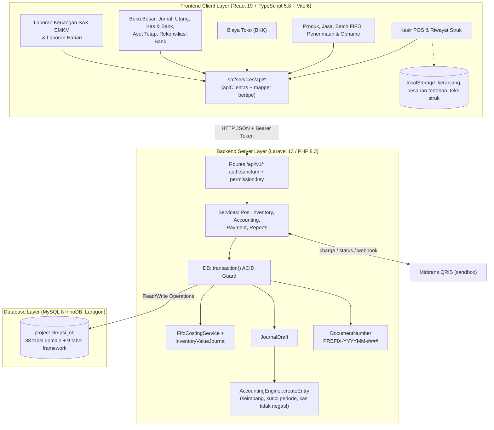

# Spesifikasi Arsitektur Sistem & Landasan Rasionalisasi Pemilihan Teknologi
**Sistem Point of Sale (POS) & Sistem Informasi Akuntansi (SIA) Berbasis Website Berstandar SAK EMKM**  
*Studi Kasus: Toko Ban dan Velg Omah Ban Cabang 3 (OB3)*

---

### Informasi Proyek & Konteks Akademik
- **Judul Skripsi:** *Perancangan Sistem Point of Sale (POS) dan Sistem Informasi Akuntansi Berbasis Website dengan Metode Rapid Application Development pada Toko Ban dan Velg Omah Ban Cabang 3*
- **Peneliti / Pengembang:** Catherine Wong
- **NIM:** 23.G4.0007
- **Program Studi:** Program Studi Akuntansi (Program Ganda: Akuntansi & Sistem Informasi), Fakultas Ekonomi dan Bisnis, Universitas Katolik Soegijapranata Semarang
- **Objek Penelitian:** Toko Ban dan Velg Omah Ban Cabang 3 (OB3) — Magelang, Jawa Tengah
- **Pemilik Usaha (Owner):** Agus Subagyo

*Dokumen ini diselaraskan dengan kode sumber per 5 Oktober 2026. Apabila terdapat perbedaan, kode sumber, migrasi basis data, dan pengujian otomatis menjadi acuan akhir.*

---

## 1. Spesifikasi Teknis Sistem (System Specification)

Sistem dibangun menggunakan arsitektur **Decoupled Client-Server (Full-Stack RESTful)** yang memisahkan antarmuka pengguna (*presentation layer*) dari mesin logika bisnis finansial (*business logic & data layer*). Server merupakan satu-satunya sumber kebenaran (*single source of truth*) untuk uang, stok, akuntansi, dan nomor dokumen; antarmuka hanya mengirim maksud transaksi dan menampilkan hasil yang dikembalikan server.

---

### 1.1 Spesifikasi Frontend (Client-Side)

* **Runtime & Framework:** React 19 (`react` ^19.0.1) Single Page Application (SPA), tanpa *router*; perpindahan layar dikendalikan oleh *state* di `src/App.tsx`.
* **Bahasa Pemrograman:** TypeScript (~5.8.2). Gerbang pemeriksaan tipe adalah `tsc --noEmit` (`npm run lint`).
* **Build Tool & Tooling:** Vite 6 (`vite` ^6.2.3) di port 3000; pengujian unit dengan Vitest (`vitest` ^5.0.0).
* **Styling & User Interface:** Tailwind CSS v4 (`@tailwindcss/vite` ^4.1.14) dan Lucide React (`lucide-react` ^0.546.0) untuk ikon. Teks antarmuka berbahasa Indonesia dengan format angka dan tanggal `id-ID`.
* **Engine Generator Ekspor** (`src/shared/export/`, satu registri laporan dengan penulis per format):
  * Spreadsheet: `exceljs` (^4.4.0) untuk `.xlsx`.
  * Dokumen cetak: `pdfmake` (^0.2.23) untuk PDF berkop toko.
  * Pengolah kata: `docx` (^9.7.1) untuk `.docx`.
  * Data mentah: penulis CSV internal.
* **Arsitektur Service Layer** (`src/services/api/`), klien bertipe untuk REST API Laravel:
  * `apiClient.ts`: klien dasar Fetch; mengirim token sebagai `Authorization: Bearer`, menerapkan batas waktu, membakukan galat menjadi `ApiError`, dan mengeluarkan pengguna otomatis bila server menjawab 401.
  * `authApi.ts`: login, logout, dan pemulihan sesi (`/auth/me`).
  * `posApi.ts` + `posMappers.ts`: checkout kasir, riwayat struk, void, dan retur penjualan.
  * `paymentApi.ts`: QRIS dinamis Midtrans (charge, status, simulasi sandbox) dan opsi penyedia pembayaran.
  * `productApi.ts`: katalog produk, jasa, kategori, dan pemasok.
  * `inventoryApi.ts` + `inventoryMappers.ts`: penerimaan barang, batch FIFO, kartu stok, stock opname, retur pembelian, dan valuasi persediaan.
  * `stockReconciliationApi.ts`: impor stok dari Excel (pratinjau, resolusi, *commit*) dan pembaruan selektif.
  * `expenseApi.ts`: Bukti Kas Keluar (BKK) dan pembatalannya (*void*).
  * `accountingApi.ts` + `accountingMappers.ts`: COA, jurnal umum, jurnal manual dan pembaliknya, buku besar, neraca saldo, utang usaha, saldo awal, tutup/buka periode, dan laporan keuangan.
  * `cashApi.ts`: shift kasir, persetujuan selisih kas, setoran kas ke bank, Prive, dan setoran modal.
  * `sakEmkmApi.ts`: aset tetap, penyusutan, AJP, rekonsiliasi bank, dan CALK.
  * `reportsApi.ts`: laporan kas harian dan rekap harian (juga sumber angka dasbor).
* **Tidak ada mekanisme *fallback* luring.** Fitur uang, stok, dan akuntansi tidak lagi menulis data lokal ataupun ke Supabase; kegagalan permintaan ditampilkan sebagai pesan galat dengan opsi coba lagi. `localStorage` hanya menyimpan token sesi, keranjang (`ob3_cart`), pesanan tertahan (`ob3_parked_orders`), teks struk/toko (`ob3_store_settings`), dan status baca notifikasi.

---

### 1.2 Spesifikasi Backend (Server-Side)

* **Runtime & Framework:** PHP 8.3 (`php` ^8.3) dengan Laravel 13 (`laravel/framework` ^13.17), berjalan di port 8000.
* **Autentikasi:** Laravel Sanctum (`laravel/sanctum` ^4.0) dengan *personal access token* yang dikirim sebagai *bearer token*; token kedaluwarsa setelah 720 menit (`SANCTUM_EXPIRATION`), dan login dibatasi 5 percobaan per menit.
* **Pustaka tambahan:** `phpoffice/phpspreadsheet` (^5.9) untuk membaca berkas Excel stok. Integrasi Midtrans memakai HTTP client Laravel tanpa SDK pihak ketiga.
* **Protokol Komunikasi:** RESTful API berawalan `/api/v1/` dengan keluaran `application/json` (`{success, message, data}`); pelanggaran aturan bisnis dijawab HTTP 422 dengan pesan berbahasa Indonesia.
* **Otorisasi deny-by-default:** setiap rute terlindungi memakai *middleware* `permission:<key>`. Terdapat **21 kunci izin** (`backend/app/Support/Permissions.php`) dan tiga peran: **OWNER** (selalu lolos), **KASIR** (bawaan: `pos`, `receipt`, `cash_session`, `sales_return`, `daily_reports`), dan **GUDANG** (bawaan: `inventory_view`, `inventory_manage`, `goods_receipt`, `stock_opname`, `purchase_return`). Matriks KASIR/GUDANG dapat diubah OWNER dan disimpan di tabel `role_permissions`; izin yang tidak tercatat berarti ditolak.
* **Arsitektur Pengontrol & Layanan:**
  * `App\Http\Controllers\Api`: pengontrol per domain (`PosController`, `PurchaseController`, `InventoryController`, `ExpenseController`, `AccountingReportController`, `CashSessionController`, `FixedAssetController`, `BankReconciliationController`, `CalkController`, `DailyReportController`, dan lainnya). Pengontrol hanya memvalidasi masukan (sering melalui *FormRequest*) lalu memanggil layanan.
  * `App\Services\Pos\`: `CheckoutService`, `CartLines`, `PosAccounts` (pemetaan metode bayar ke akun), `SaleVoidService`, `SalesReturnService`.
  * `App\Services\Inventory\`: `GoodsReceiptService`, `PayableService`, `PurchaseReturnService`, `StockOpnameService`, `StockOpnameCommitService`, `StockExcelImportService`, `StockSelectiveUpdateService`, `MonthlyStockLedgerService`, `InventoryValueJournal`.
  * `App\Services\Accounting\`: `ExpenseService`, `ManualJournalService`, `OpeningBalanceService`, `PeriodClosingService`, `PeriodLock`, `CashSessionService`, `CashMovementService`, `FixedAssetService`, `DepreciationService`, `AdjustingEntryService`, `BankReconciliationService`, serta pembentuk laporan `LedgerBalances`, `FinancialReportService`, `CashFlowReport`, dan `CalkReport`.
  * `App\Services\Payment\MidtransQrisService`: QRIS dinamis Midtrans (mode *sandbox* bawaan, tanpa kunci cadangan).
  * `App\Services\Reports\DailyReportService`: laporan kas harian dan rekap harian yang dihitung dari jurnal.
* **Inti akuntansi:**
  * `JournalDraft`: penyusun jurnal berbasis kode akun (`debit()`, `credit()`, `post()`); kode akun yang tidak dikenal ditolak.
  * `AccountingEngine::createEntry()`: satu-satunya penulis tabel `journal_entries`/`journal_items`. Mesin ini membulatkan setiap baris ke sen, menolak baris bernilai negatif dan baris yang sekaligus berisi debit dan kredit, mewajibkan sekurang-kurangnya dua baris dengan $\sum \text{Debit} = \sum \text{Kredit}$ tepat sampai sen (tanpa toleransi), serta menolak tanggal jurnal yang jatuh pada atau sebelum tanggal kunci periode (`PeriodLock`). Sejak 5 Oktober 2026, saldo **Kas Laci (1-1000)** dan **Bank BCA (1-1001)** tidak boleh negatif: setiap jurnal yang mengkredit akun tersebut diperiksa terhadap saldo kumulatif pada tanggal jurnal dan seluruh tanggal sesudahnya, sehingga transaksi yang ditanggalkan mundur pun tidak dapat membuat hari berikutnya bersaldo negatif.
  * `DocumentNumber::next()`: penomoran dokumen berurutan per bulan dengan format `PREFIX-YYYYMM-####` (misalnya `OB3-INV-`, `GR-`, `BKK-`, `JRN-`, `RTJ-`, `RTB-`, `OPN-`, `AT-`, `AJP-`, `KAS-`), diambil di dalam transaksi basis data dengan penguncian baris agar tidak terjadi nomor ganda.
  * `FifoCostingService` mengalokasikan penjualan ke batch tertua (`purchase_date`, lalu `id`), dan `InventoryValueJournal` menjurnal setiap perubahan nilai stok di luar penjualan dan pembelian, sehingga saldo akun **1-2000 = Σ(`remaining_qty` × `batch_cost`)**. Kesesuaian ini dapat diperiksa melalui `GET /inventory/valuation`.
* **Keamanan Transaksi Data:** seluruh operasi multi-tabel (misalnya checkout yang mencakup stok, batch, faktur, pembayaran, dan jurnal) dibungkus dalam `DB::transaction()`. Alur yang rawan kebuntuan (*deadlock*) diulang hingga tiga kali, dan urutan penguncian (produk sebelum batch, diurutkan menurut `id`) dibakukan agar tidak terbentuk siklus kunci.

---

### 1.3 Spesifikasi Basis Data (MySQL 8)

* **Engine:** MySQL 8 (Laragon) dengan mesin penyimpanan bawaan **InnoDB** (transaksi ACID dan *foreign key constraints*). Seluruh nilai uang disimpan sebagai `decimal(15,2)`.
* **Nama Database:** `project-skripsi_ob` (pengujian otomatis memakai `project-skripsi_ob_testing`).
* **Skema:** dibangun dari 37 berkas migrasi di `backend/database/migrations/` (terakhir `2026_10_05_000003`), menghasilkan **47 tabel**: 38 tabel domain dan 9 tabel infrastruktur framework. Tabel dokumen utama (mis. `sales`, `products`, `journal_entries`, `expenses`) memiliki `branch_id` (bawaan 3); sistem dirancang untuk satu cabang.
* **Tabel domain aktif (35):**
  * *Autentikasi & otorisasi:* `users` (`username`, `role` OWNER/KASIR/GUDANG, `is_active`), `role_permissions` (`role`, `permission_key`, `allowed`).
  * *Katalog:* `products` (`product_code`, `product_name`, `brand_id`, `size_width`, `size_ratio`, `ring`, `product_cost`, `product_price`, `product_quantity`, `is_active`), `product_categories`, `brands`, `brand_aliases`, `service_masters` (`service_code`, `service_name`, `standard_price`), `service_categories`, `suppliers` (`supplier_code`, `payment_terms_days`), `product_price_audits`.
  * *Persediaan FIFO:* `product_batches` (`batch_code`, `purchase_date`, `batch_cost`, `initial_qty`, `remaining_qty`, `purchase_id`), `stock_movements` (`movement_type` MASUK/KELUAR/PENYESUAIAN, `quantity`, `balance_after`, `reference_type`, `reference_id`), `sale_batch_allocations` (`quantity_allocated`, `quantity_returned`, `unit_cost`, `total_cost`).
  * *Penjualan (POS):* `sales` (`reference` `OB3-INV-YYYYMM-####`, `gross_sales_amount`, `discount_amount`, `total_amount`, `payment_method`, `status` LUNAS/VOID, `total_hpp`, `user_id`), `sale_details` (`item_type` PRODUCT/SERVICE, `quantity`, `sub_total`, `hpp`), `sale_payments` (`method`, `account_code`, `amount`, `fee_amount`, `net_received`), `qris_transactions` (`order_id`, `gross_amount`, `transaction_status`, `sale_payment_id`), `sales_returns` (`reference` `RTJ-…`, `refund_amount`, `cost_amount`, `cash_session_id`), `sales_return_items`.
  * *Pembelian & utang:* `purchases` (`purchase_number` `GR-…`, `payment_method` TUNAI/TRANSFER_BCA/TEMPO, `total_amount`, `dpp_amount`, `ppn_amount`, `paid_amount`, `returned_amount`, `status` LUNAS/BELUM_LUNAS/SEBAGIAN/BATAL), `purchase_payments`, `purchase_returns` (`reference` `RTB-…`, `kind` RETURN/CANCEL), `purchase_return_items`.
  * *Pengaturan pembayaran:* `payment_provider_settings` (`method_type` bank/qris, `provider_name`, `fee_percentage`, `fee_threshold_amount`).
  * *Akuntansi:* `accounts` (`account_code`, `account_name`, `account_type`, `normal_balance`, `is_active`), `journal_entries` (`entry_number` `JRN-…`, `entry_date`, `reference_type`, `reference_id`, `total_debit`, `total_credit`, `status`, `created_by`, `reversal_of_id`), `journal_items` (`account_id`, `debit`, `credit`, `note`), `accounting_period_closings`, `expense_categories` (`category_code`, `default_account_code`), `expenses` (`reference` `BKK-…`, `amount`, `status` ACTIVE/VOID, `void_reason`).
  * *Kas & shift:* `cash_sessions` (`opening_float`, `expected_cash`, `counted_cash`, `variance`, `variance_reason`, `status` OPEN/PENDING_APPROVAL/CLOSED, `approved_by`).
  * *Aset tetap & rekonsiliasi bank:* `fixed_assets` (`code` `AT-…`, `acquisition_cost`, `residual_value`, `useful_life_months`, `status`), `fixed_asset_depreciations` (`period`, `amount`), `bank_statement_lines`, `bank_reconciliations`.
* **Tabel historis (3, tidak dipakai sejak 30 September 2026):** `sales_bookings`, `receivable_payments`, dan `edc_settings`. Fitur uang muka pemesanan (DP), penjualan kredit (BON), dan pembayaran kartu EDC telah dihapus dari sistem; tabelnya dipertahankan semata-mata agar data historis tetap dapat ditelusuri.
* **Tabel infrastruktur framework (9):** `migrations`, `personal_access_tokens` (token Sanctum), `sessions`, `cache`, `cache_locks`, `jobs`, `job_batches`, `failed_jobs`, `password_reset_tokens`.
* **Bagan Akun (COA):** **33 akun** dari `AccountCoaSeeder` dan migrasi pendukungnya; tiga di antaranya nonaktif (1-1002 Piutang Dagang, 2-1004 Uang Muka Pelanggan, 4-2000 Pendapatan Surcharge EDC) dan hanya dipertahankan untuk jurnal historis. Ringkasannya:
  * *Aset (1-xxxx):* Kas Laci 1-1000, Bank BCA 1-1001, Beban Dibayar di Muka 1-1100, Persediaan 1-2000, Peralatan & Mesin Spooring 1-3000, Akumulasi Penyusutan 1-3999.
  * *Liabilitas (2-xxxx):* Hutang Dagang 2-1000, Beban Yang Masih Harus Dibayar 2-1100.
  * *Ekuitas (3-xxxx):* Modal Disetor 3-1000, Laba Ditahan 3-2000, Prive 3-3000.
  * *Pendapatan (4-xxxx):* Penjualan Ban 4-1000, Jasa Servis & Spooring 4-1001, Bunga Bank 4-3000, serta kontra-pendapatan Potongan Diskon 4-9000 dan Retur Penjualan 4-9100.
  * *Beban (5-xxxx, 6-xxxx):* HPP 5-1000, Selisih Persediaan 5-2000, beban operasional 6-1000 s.d. 6-1008, MDR QRIS 6-1009, Selisih Kas Kasir 6-1010, Penyusutan 6-1011, Administrasi Bank 6-1012.
  * Tidak ada akun PPN: toko berstatus non-PKP.

---

### 1.4 Modul dan Fitur yang Dibangun

Setiap peristiwa bisnis di bawah ini berakhir pada jurnal berpasangan yang seimbang melalui `AccountingEngine`.

1. **Kasir (POS).** Checkout dengan pembayaran Tunai, Transfer, atau QRIS (dinamis melalui Midtrans, atau stiker statis), tunggal maupun terpisah (*split*); setiap penjualan dibayar lunas saat itu juga. Tidak ada PPN atas penjualan. MDR QRIS dibebankan ke 6-1009 dan HPP dihitung FIFO. Tersedia void penjualan (jurnal pembalik, stok kembali ke batch asal) dan retur penjualan sebagian dengan pengembalian uang tunai dari laci (4-9100).
2. **Shift kasir.** Pembukaan shift dengan modal awal, penutupan dengan hitung fisik laci, dan selisih kas yang wajib diberi alasan serta disetujui OWNER sebelum dijurnal ke 6-1010 Selisih Kas Kasir. Pembayaran tunai dan retur mewajibkan shift terbuka. Tersedia pula setoran kas ke bank, Prive, dan setoran modal.
3. **Penerimaan barang & utang.** Penerimaan barang (`GR-…`) secara tunai, transfer, atau tempo; PPN pada faktur pemasok (DPP + PPN) dikapitalisasi ke harga pokok persediaan, tanpa akun PPN Masukan. Pembayaran utang dicatat per faktur dengan status BELUM_LUNAS/SEBAGIAN/LUNAS.
4. **Retur pembelian & pembatalan penerimaan.** Retur unit yang masih tersisa di batch penerimaan (mengurangi utang lebih dahulu, sisanya sebagai pengembalian dana), atau pembatalan penerimaan yang belum tersentuh melalui jurnal pembalik (status BATAL).
5. **Persediaan.** Katalog produk dan jasa, kartu stok, buku batch FIFO, stock opname (selisih ke 5-2000), dan laporan stok bulanan FIFO. Impor stok dari Excel dan pembaruan stok selektif hanya diizinkan sebelum *go-live*; *go-live* ditandai oleh jurnal saldo awal persediaan yang hanya dapat diposting satu kali.
6. **Biaya toko.** Bukti Kas Keluar (BKK) per kategori beban, beserta pembatalannya melalui jurnal pembalik.
7. **Jurnal manual & saldo awal.** Jurnal umum manual (akun kontrol seperti persediaan, utang, dan aset tetap ditolak) yang dapat dibalik satu kali, serta saldo awal akun yang diposting satu kali.
8. **Aset tetap.** Register aset sebagai buku pembantu 1-3000/1-3999, penyusutan garis lurus bulanan (kumulatif per sen sehingga tidak terjadi penyusutan ganda), dan pembatalan aset yang salah input selama bulan penyusutannya belum dikunci.
9. **Ayat Jurnal Penyesuaian (AJP).** Beban akrual (kredit 2-1100) dengan opsi pembalikan otomatis pada tanggal 1 bulan berikutnya, serta pemakaian beban dibayar di muka (kredit 1-1100).
10. **Rekonsiliasi bank.** Mutasi rekening koran (manual atau CSV) dicocokkan satu-satu dengan baris jurnal 1-1001, pencocokan otomatis, serta pembukuan biaya administrasi dan bunga bank yang belum tercatat.
11. **Tutup & buka periode.** Penutupan bulanan memindahkan saldo pendapatan dan beban ke 3-2000 lalu mengunci periode; pembukaan kembali hanya oleh OWNER melalui jurnal pembalik. Penutupan ditolak selama penyusutan bulan tersebut belum dibukukan.
12. **Laporan keuangan** (dihitung server per periode langsung dari jurnal): Jurnal Umum, Buku Besar, Neraca Saldo, Laporan Laba Rugi, Laporan Posisi Keuangan, Laporan Perubahan Ekuitas, Laporan Arus Kas (metode langsung), dan Catatan atas Laporan Keuangan (CALK).
13. **Laporan harian & dasbor.** Laporan kas harian, rekap harian, rekap per kasir (KASIR hanya melihat nota dan shift miliknya), serta angka uang pada dasbor yang seluruhnya dihitung dari jurnal.
14. **Ekspor.** Laporan dapat diekspor ke PDF, XLSX, DOCX, dan CSV sesuai format yang diizinkan per laporan.

---

### 1.5 Pengujian

* **Pengujian otomatis backend:** PHPUnit 12 terhadap basis data MySQL `project-skripsi_ob_testing`; per 5 Oktober 2026 sebanyak **352 pengujian** lulus. Pengujian mencakup keseimbangan jurnal, kesesuaian 1-2000 dengan nilai FIFO, kunci periode, otorisasi per peran, dan larangan saldo kas/bank negatif.
* **Pengujian otomatis frontend:** Vitest untuk logika klien (pemeta data, registri ekspor, perhitungan laporan); per 5 Oktober 2026 sebanyak **176 pengujian** lulus, dan pemeriksaan tipe `tsc --noEmit` bersih.
* **Pengujian manual melalui peramban** atas alur utama aplikasi dilakukan pada 5 Oktober 2026; temuan yang diperoleh telah diperbaiki.

---

## 2. Landasan Rasionalisasi & Justifikasi Pemilihan Teknologi

Pemilihan kombinasi teknologi di atas didasarkan pada pertimbangan kebutuhan lapangan operasional toko ban serta pemenuhan standar ilmiah akademis:

### 2.1 Mengapa Frontend Menggunakan React 19 + TypeScript + Vite?
1. **Kecepatan & Pengalaman Meja Kasir (SPA):** Kasir toko ban bekerja secara cepat dengan antrean pelanggan di bengkel. SPA berbasis React 19 membuat pencarian ukuran ban, pengisian data kendaraan, dan perhitungan kembalian terjadi seketika tanpa memuat ulang halaman.
2. **Keandalan Data Finansial (TypeScript):** Masalah umum pada JavaScript murni adalah *type coercion* (misalnya nominal `"500000"` diperlakukan sebagai teks saat dijumlahkan). TypeScript mencegah kesalahan semacam ini pada perhitungan tampilan keranjang, diskon per item dan per nota, pembagian pembayaran, serta pemetaan respons server ke tipe antarmuka. Perhitungan resmi atas uang, HPP, dan jurnal tetap dilakukan di server.
3. **Efisiensi Pengembangan RAD (Vite HMR):** Kompilasi instan Vite mendukung siklus iterasi cepat dalam metode *Rapid Application Development* (RAD) saat menguji kebutuhan pengguna secara langsung.

---

### 2.2 Mengapa Backend Menggunakan Laravel 13 (PHP 8.3) REST API?
1. **Jaminan Integritas Transaksi ACID (`DB::transaction()`):** Satu checkout kasir melibatkan beberapa proses serentak:
   * Penguncian dan pengurangan `product_quantity` pada `products`.
   * Pemotongan `remaining_qty` pada batch tertua di `product_batches` dan pencatatan `sale_batch_allocations`.
   * Pencatatan nota `sales`, rincian `sale_details`, dan pembayaran `sale_payments`.
   * Pembukuan jurnal berpasangan di `journal_entries` dan `journal_items`.
   Jika satu langkah gagal (misalnya stok batch tidak mencukupi atau jurnal tidak seimbang), seluruh proses dibatalkan (*rollback*), sehingga tidak terjadi anomali seperti uang tercatat masuk namun stok tidak berkurang.
2. **Pemisahan Tanggung Jawab (*Separation of Concerns*):** Logika akuntansi, penentuan HPP, perhitungan biaya MDR, dan penomoran dokumen berada di server. Perangkat kasir tetap ringan, dan aturan bisnis tidak dapat dimanipulasi dari peramban.
3. **Keamanan Bawaan:** Sanctum menyediakan autentikasi berbasis token yang sederhana untuk SPA, sementara *middleware* izin memungkinkan penerapan prinsip *deny-by-default* pada setiap rute.

---

### 2.3 Mengapa Basis Data Menggunakan MySQL 8 InnoDB?
1. **Integritas Relasional Kuat:** Transaksi akuntansi saling terikat. InnoDB mendukung *foreign key constraints*, misalnya `journal_items.account_id` yang mencegah penghapusan akun yang sudah memiliki baris jurnal. Untuk produk, jasa, dan pemasok yang sudah memiliki riwayat transaksi, sistem menonaktifkan data alih-alih menghapusnya.
2. **Dukungan Penguncian Baris:** Penguncian baris InnoDB (`lockForUpdate`/`sharedLock`) dipakai untuk penomoran dokumen berurutan, alokasi batch FIFO, dan pemeriksaan saldo kas, sehingga transaksi yang berjalan bersamaan tetap konsisten.
3. **Kesesuaian dengan Skala UMKM:** MySQL andal, ringan, dan kompatibel langsung dengan server lokal (Laragon) maupun layanan hosting yang terjangkau.

---

### 2.4 Mengapa Menggunakan Metode Penilaian Persediaan FIFO (*First-In, First-Out*)?
1. **Karakteristik Fisik Komoditas Ban:** Ban terbuat dari senyawa karet yang mengalami penuaan sejak tanggal produksi (kode DOT). Ban yang diterima lebih awal sebaiknya terjual lebih dahulu untuk mencegah penurunan kualitas di gudang, sehingga aliran biaya FIFO sejalan dengan aliran fisik barang.
2. **Objektivitas Penentuan HPP:** Harga beli dari distributor berubah mengikuti bahan baku dan kurs. FIFO memastikan HPP yang diakui mencerminkan harga batch tertua yang benar-benar keluar, dan nilai persediaan akhir pada Laporan Posisi Keuangan mencerminkan harga perolehan terbaru.
3. **Biaya Perolehan yang Lengkap:** Karena toko non-PKP, PPN pada faktur pemasok tidak dapat dikreditkan, sehingga dikapitalisasi ke biaya batch. Nilai faktur (DPP + PPN) dibagi tepat sampai sen ke dalam batch, sehingga saldo 1-2000 selalu sama dengan Σ(`remaining_qty` × `batch_cost`).

---

### 2.5 Mengapa Menggunakan Standar Akuntansi Keuangan SAK EMKM & *Auto-Journaling*?
1. **Kepatuhan Terhadap Standar IAI untuk UMKM:** SAK EMKM (Standar Akuntansi Keuangan Entitas Mikro, Kecil, dan Menengah) diterbitkan oleh Dewan Standar Akuntansi Keuangan Ikatan Akuntan Indonesia dengan asas kesederhanaan. Laporan keuangan minimum menurut SAK EMKM terdiri atas:
   * **Laporan Posisi Keuangan**
   * **Laporan Laba Rugi**
   * **Catatan atas Laporan Keuangan (CALK)**

   Sebagai pelengkap untuk kebutuhan manajerial, sistem juga menyajikan **Laporan Arus Kas** (metode langsung) dan **Laporan Perubahan Ekuitas**. CALK memuat pernyataan kepatuhan terhadap SAK EMKM, kebijakan akuntansi (dasar penyusunan, kas dan bank, persediaan FIFO, penyusutan garis lurus, pendapatan, beban akrual, dan perpajakan), serta rincian akun yang berasal dari jurnal yang sama dengan neraca.
2. **Perlakuan Perpajakan:** Toko berstatus non-PKP sehingga tidak memungut PPN atas penjualan. PPh Final 0,5% dari peredaran bruto (PP Nomor 55 Tahun 2022) hanya dinyatakan sebagai kebijakan dalam CALK; sistem tidak menghitung atau mencadangkannya secara otomatis (keputusan pengguna), dan pajak yang disetor dicatat sebagai beban 6-1008 pada saat pembayaran.
3. **Otomatisasi Tanpa Membebani Kasir (*Zero-Accounting Barrier*):** Karyawan operasional umumnya tidak memiliki kompetensi akuntansi. Fitur *auto-journaling* menyembunyikan kompleksitas tersebut: kasir dan staf gudang cukup mencatat penjualan, penerimaan barang, atau biaya, dan sistem membukukan jurnal debit-kredit yang seimbang ($\Delta = 0$) secara otomatis.

---

### 2.6 Mengapa Diterapkan Pengendalian Internal dalam Sistem?

Romney dan Steinbart (*Accounting Information Systems*) menekankan bahwa SIA harus dilengkapi pengendalian umum dan pengendalian aplikasi agar data yang dihasilkan dapat diandalkan. Sistem menerapkan pengendalian berikut:

1. **Pemisahan fungsi (*segregation of duties*):** peran KASIR (penjualan, shift, retur penjualan), GUDANG (penerimaan barang, opname, retur pembelian), dan OWNER (otorisasi, laporan, persetujuan) dipisahkan melalui izin *deny-by-default* yang ditegakkan di server, bukan sekadar disembunyikan di antarmuka. Void penjualan secara bawaan hanya dimiliki OWNER.
2. **Otorisasi selisih kas:** selisih antara hitung fisik laci dan saldo buku wajib diberi alasan dan hanya dijurnal ke 6-1010 setelah disetujui; pengguna non-OWNER tidak dapat menyetujui shift miliknya sendiri.
3. **Pemeriksaan tanda dan batas (*sign check* dan *limit check*):** jurnal dengan baris negatif atau dua sisi ditolak, jurnal harus seimbang tepat sampai sen, penjualan melebihi lapisan batch FIFO ditolak, dan saldo Kas Laci (1-1000) maupun Bank (1-1001) tidak boleh menjadi negatif pada tanggal mana pun.
4. **Kunci periode:** setelah suatu bulan ditutup, tidak ada jurnal yang dapat diposting pada atau sebelum tanggal kunci, sehingga laporan yang telah diterbitkan tidak berubah. Pembukaan kembali hanya oleh OWNER dan meninggalkan jejak jurnal.
5. **Jejak audit (*audit trail*):** jurnal tidak pernah diubah atau dihapus. Koreksi dilakukan dengan jurnal pembalik yang ditautkan ke jurnal asal (`reversal_of_id`, paling banyak satu pembalik per jurnal) atau dengan dokumen baru (retur). Setiap jurnal mencatat pembuatnya (`created_by`), dan pembatalan BKK maupun void penjualan mencatat alasan, pelaku, dan waktunya.
6. **Pengendalian akun kontrol:** akun persediaan, utang dagang, dan aset tetap hanya dapat diubah melalui modul sumbernya (penerimaan barang, pembayaran utang, register aset), bukan melalui jurnal manual, sehingga buku besar tetap sesuai dengan buku pembantunya.

---

### 2.7 Mengapa Menggunakan Metode Pengembangan Rapid Application Development (RAD)?
1. **Siklus Umpan Balik Cepat dengan Pemilik Usaha (Owner):** Toko ban memiliki dinamika operasional yang khas (misalnya pencatatan data kendaraan, cetak nota termal 80 mm, dan beban perawatan mesin spooring). RAD memungkinkan prototipe antarmuka dibuat, diujikan langsung kepada pemilik toko (Bapak Agus Subagyo), dan disempurnakan dalam waktu singkat.
2. **Kesesuaian Waktu Tugas Akhir:** RAD memangkas tahapan dokumentasi yang kaku menjadi iterasi fungsional (*Requirements Planning $\rightarrow$ User Design $\rightarrow$ Construction $\rightarrow$ Cutover*). Dalam proyek ini, pemindahan fitur dari penyimpanan lokal ke server dilakukan bertahap (autentikasi, POS, persediaan, akuntansi, kas dan bank, kelengkapan SAK EMKM, laporan operasional), sehingga setiap tahap dapat diuji sebelum tahap berikutnya dimulai.

---

## 3. Matriks Keselarasan Capaian Skripsi Ganda

| Dimensi Program Studi | Tantangan Bisnis Omah Ban Cabang 3 | Solusi Teknis / Konseptual yang Diterapkan |
| :--- | :--- | :--- |
| **Sistem Informasi** | Kasir lambat, data tersebar, rawan salah hitung, proses tidak transparan. | SPA React 19 + TypeScript yang terhubung ke REST API Laravel 13 sebagai sumber kebenaran tunggal, dengan transaksi atomik ACID, otorisasi berbasis peran *deny-by-default*, integrasi QRIS Midtrans, dan pelaporan otomatis. |
| **Akuntansi** | Pembukuan manual belum standar, HPP ban yang fluktuatif tidak terlacak, laporan keuangan sulit disusun. | Penilaian persediaan FIFO *real-time* dengan PPN pembelian dikapitalisasi, COA 33 akun yang selaras dengan SAK EMKM, *auto-journaling* debit-kredit seimbang, serta Laporan Posisi Keuangan, Laba Rugi, dan CALK (dilengkapi Arus Kas dan Perubahan Ekuitas). |
| **Pengendalian Internal** | Kas laci dan stok rawan selisih tanpa jejak, koreksi dilakukan dengan menimpa catatan. | Pemisahan fungsi kasir/gudang/pemilik, persetujuan selisih kas oleh OWNER, kunci periode, larangan saldo kas/bank negatif, dan koreksi melalui jurnal pembalik sebagai jejak audit. |
